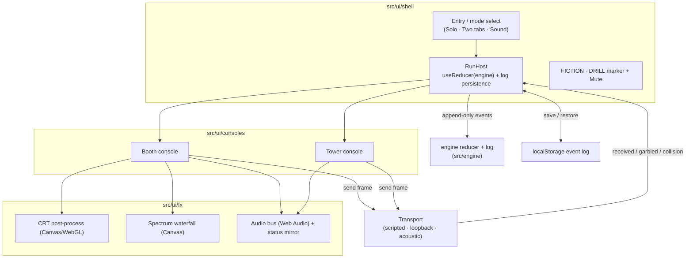

# Design: consoles (Booth and Tower)

Generated by Kiro from `requirements.md`. This design covers the UI layer of
Dead Air: the Shell that chooses a play mode and holds the run, the two role
consoles (Booth phosphor teletype + waterfall, Tower pager handheld), decision
capture, accessibility, and resilience/persistence. The consoles are the costume
and the controls — they read engine state and dispatch events; they never mutate
state directly.

> **Note (developer, 2026-11-23):** where this design describes the CRT layer
> (scanlines, curve, bloom), the all-caps `FICTION · DRILL` marker, or a centred
> fixed-aspect panel, the "Decisions (developer, 2026-11-23)" section in
> `tasks.md` takes precedence, together with `design-language.md`.

## Overview

The consoles sit at the top of the one-way import chain
(`ui -> transport -> modem/channel -> engine`). They subscribe to a running
`Transport` for wire outcomes, fold those outcomes plus participant decisions
into an append-only event log, and derive everything they draw from a pure
reducer. No console reaches past the transport; `engine` imports nothing from
the UI.

Two consoles share one interaction grammar but wear different costumes:

- **Booth** — a phosphor teletype. Wire text prints character-by-character at
  the link's baud rate over a live spectrum waterfall of the audio link, with a
  carrier lamp (`IDLE` / `SENDING` / `RECEIVING` / `COLLISION`). The Booth
  player composes free text up to 64 bytes.
- **Tower** — a pager-style handheld. A small display, three hardware-style
  keys, a list of canned codes plus free text, and an inbound alert (sound +
  lamp + text line) that keeps the last 8 messages scrollable.

The Shell offers three ways to play the same scenario — Solo (scripted partner),
Two tabs (loopback), Two devices by sound (acoustic) — selecting the matching
`Transport` from the signal-chain layer. Everything the consoles render traces
back to engine state so that a reload rebuilds the exact run from the event log
in local storage, and the whole thing works offline after first load.

### Scope and boundaries

- New code lives in `src/ui/` only: `shell/`, `consoles/booth/`,
  `consoles/tower/`, `fx/` (`crt`, `waterfall`, `audio`). The Séance debrief is
  owned by the `seance-replay` spec; this design stops at handing it a finished
  log.
- Rendering uses React for structure and controls and hand-written Canvas 2D /
  WebGL for the CRT post-process and the waterfall. No CSS framework, no
  component library, no 3D framework.
- The consoles dispatch engine actions and append to the log; they never write
  derived state. All randomness that the consoles observe arrives through a
  `Transport` (ultimately the seeded PRNG in `src/channel/prng.ts`); console
  code itself contains no `Math.random`-driven simulation.
- Visual rules (palette, type, texture, motion, sound-as-information) come from
  `.kiro/steering/design-language.md` and are treated as binding constraints,
  not re-specified here.

## Architecture



### Data flow

1. **Mode select.** The Entry screen lets the judge choose Solo, Two tabs, or
   Two devices by sound. It constructs the matching `Transport` (scripted,
   loopback, acoustic) from the signal-chain layer and hands it to `RunHost`.
2. **Run.** `RunHost` holds the engine state with `useReducer(reduce, scenario,
   initialState)` and an append-only log. It subscribes to the transport; each
   `received | garbled | collision` outcome is appended as one engine event with
   no reshaping (the transport event is already the engine event shape). The
   active console renders `eventsForRole(...)` for its role.
3. **Compose / send.** A console builds a `TransportFrame` (sender, recipient,
   payload bytes, send time) and calls `transport.send(...)`. The console reads
   `transport.mode` for the carrier lamp; while `transmitting`, inbound decoding
   is suppressed by the transport, so the lamp shows `SENDING`.
4. **Decision.** When a beat asks for a decision, the console dispatches
   `recordDecision` with the role, option id, and the reached `cursorSimTime`.
   The console locks that choice once the next beat begins.
5. **Persist.** On every log append `RunHost` serialises the log to local
   storage. On load it restores the log and replays it through the reducer to
   rebuild the exact run.
6. **Debrief.** At the end, `RunHost` passes the finished log to the Séance
   (owned by `seance-replay`).

### Mode → transport mapping (Req 1.1, 1.2)

| Mode | One-sentence pitch | Transport | First-beat path |
| --- | --- | --- | --- |
| Solo | Play both sides against a scripted partner on one laptop. | `ScriptedTransport` | Pick Solo → pick a role → first beat (two interactions) |
| Two tabs | Open a second tab; the two tabs share the Wire by sound-free loopback. | `LoopbackTransport` (`BroadcastChannel`) | Pick Two tabs → first beat |
| Two devices | Two phones/laptops talk over the air by acoustic modem. | `AcousticTransport` | Pick Two devices → grant mic → first beat |

Solo is the judge path and MUST reach the first scenario beat within two
interactions (Req 1.2): the Entry choice and the role choice.

## Components and Interfaces

All components are in `src/ui/`. Props types are sketched in TypeScript; exact
signatures are settled during task execution.

### Shell (`src/ui/shell/`)

- **`Entry`** — renders the three modes with one sentence each (Req 1.1) and a
  persistent `FICTION · DRILL` marker and mute control (Req 1.3). On selection it
  resolves a `Transport` factory and advances to the run.
- **`RunHost`** — owns engine state and the log. Public contract:

  ```ts
  interface RunHostProps {
    scenario: Scenario;
    transport: Transport;        // from the signal-chain layer
    mode: PlayMode;              // "solo" | "loopback" | "acoustic"
    storageKey: string;          // localStorage key for this run
  }
  ```

  Internally it holds `useReducer(reduce, scenario, initialState)` and an
  append-only `ConsoleEvent[]` log (see Data Models). It exposes `append(event)`
  and `recordDecision(...)` to children and mirrors every sound to a status line.

- **`ConsoleFrame`** — the fixed-aspect panel chrome (one panel centred on the
  viewport, works from 360 px wide), wraps either console and mounts the CRT
  post-process layer. Holds the global mute and reduced-motion switches.
- **`StatusLine`** — a single `aria-live="polite"` region that shows the text
  twin of every sound and every colour/lamp state (Req 5.4, 2.1, 3.2).

### Booth console (`src/ui/consoles/booth/`)

- **`BoothConsole`** — composes the teleprinter, waterfall, carrier lamp, and
  composer. Reads role-visible events and transport mode from `RunHost`.
- **`Teleprinter`** — prints incoming wire text at the baud rate (Req 2.1).
  Garbled frames print with unreadable bytes **marked, never hidden** (Req 2.3) —
  each undecodable byte renders as a visible replacement glyph in signal red with
  an accessible label, so the reader sees that information was lost.
- **`Waterfall`** (`src/ui/fx/waterfall/`) — a Canvas 2D live spectrum of the
  audio link, scrolling at a fixed rate. Driven by an analyser node in acoustic
  mode and by a synthesised spectrum from transport state in solo/loopback so the
  instrument reads the same in every mode.
  _Note (developer, 2026-11-23): replaced by a static SVG signal indicator,
  `SignalIndicator` with pure model `signal.ts` in the same folder. No Canvas, no
  scroll, no synthesised spectrum. It draws only the acoustic transport's
  per-burst `airtimeMs`, `rms`, `dbfs`, `peak`; solo, loopback and acoustic
  before the first burst show plain "unavailable" text. See tasks 7.2 and 7.3._
- **`CarrierLamp`** — shows `IDLE | SENDING | RECEIVING | COLLISION` as both a
  coloured lamp and a text state (Req 2.1). State is a pure function of
  `transport.mode` plus the most recent outcome kind.
- **`Composer`** — free-text input limited to 64 bytes; shows **remaining bytes**
  and **estimated airtime** live as the player types (Req 2.2). Byte count is
  UTF-8 encoded length, not character count.

### Tower console (`src/ui/consoles/tower/`)

- **`TowerConsole`** — the pager handheld: a small display, three hardware-style
  keys, a canned-code list plus free text (Req 3.1).
- **`PagerDisplay`** — shows the current message and a scrollable history of the
  **last 8 messages** (Req 3.2); older messages drop off.
- **`PagerKeys`** — exactly three keys with fixed roles (e.g. up, down/select,
  send), each keyboard-operable with a visible focus ring and an accessible name
  (Req 5.1).
- **`InboundAlert`** — on arrival fires sound + lamp + a text line, and pushes the
  message into history (Req 3.2). The text line is the sound's twin (Req 5.4).

### Shared: decisions

- **`DecisionPrompt`** — presented by whichever console is active when a beat asks
  for a decision. Renders the options from `scenario.decisionPrompts[role]`,
  records the choice with its sim-time on select, and **locks** once the next beat
  begins (Req 4.1). It never indicates whether a choice was right (Req 4.2): no
  check marks, no colour-coding of options, no score.

### FX and audio (`src/ui/fx/`)

- **`CrtLayer`** — one post-process layer (scanlines, slight barrel curve,
  phosphor persistence, bloom) over a Canvas/WebGL surface that can be switched
  off. Text underneath passes WCAG AA without it (Req 5.3).
- **`AudioBus`** — a thin Web Audio wrapper: carrier tone, modem chirp, static
  bed, key click. Respects global mute, plays nothing before a user gesture, and
  for every sound calls into `StatusLine` so there is always a visible text twin
  (Req 5.4). Under `prefers-reduced-motion`, printing / needle / waterfall
  animation is replaced by instant state plus the status line (Req 5.2).

## Data Models

The consoles reuse engine types (`Scenario`, `SimEvent`, `SimState`,
`RecordedDecision`, `RoleId`) and transport types (`Transport`,
`TransportEvent`, `TransportFrame`). New UI-only models:

```ts
/** Which link the Shell is driving. */
type PlayMode = "solo" | "loopback" | "acoustic";

/** Carrier lamp state shown on the Booth (Req 2.1). */
type CarrierState = "IDLE" | "SENDING" | "RECEIVING" | "COLLISION";

/**
 * The append-only log the Shell persists. Each entry is either a wire outcome
 * (exactly a TransportEvent) or a recorded decision. Order is append order;
 * the reducer derives all visible state from it.
 */
type ConsoleLogEntry =
  | { kind: "wire"; event: TransportEvent }
  | { kind: "decision"; decision: RecordedDecision };

interface PersistedRun {
  version: 1;
  scenarioId: string;
  seed: number;
  mode: PlayMode;
  /** Append-only; never rewritten, only grown. */
  log: ConsoleLogEntry[];
}

/** One printed character; its bytes are [byteStart, byteStart + byteLength). */
interface PrintGlyph {
  ch: string;          // decoded character, or a marker glyph
  garbled: boolean;    // a byte in it was reported undecodable (damage)
  invalid: boolean;    // intact bytes that are not valid UTF-8 (not damage)
  byteStart: number;
  byteLength: number;  // >= 1
}
/** A line to print on the Booth teleprinter. */
interface PrintLine {
  /** Glyph byte spans tile the payload exactly, in order. */
  glyphs: PrintGlyph[];
  /** Accessible summary, e.g. "12 characters, 1 could not be read." */
  label: string;
}
/** Live composer budget shown as the player types (Req 2.2). */
interface ComposerBudget {
  usedBytes: number;      // UTF-8 encoded length
  remainingBytes: number; // 64 - usedBytes, clamped at 0
  estimatedAirtime: number;
  overLimit: boolean;     // usedBytes > 64
}
```

### Persistence model (Req 6.1, 6.2)

`PersistedRun` is written to local storage on every append. The log is the only
source of truth: restoring a run deserialises `PersistedRun`, re-subscribes the
matching transport, and replays the `log` through the reducer to rebuild
`SimState`. Because the log is append-only and the reducer is pure, replay is
deterministic — the restored run is byte-for-byte the state the player left.
Nothing is uploaded; offline works because all assets are static and the only
store is local.

### Byte budget and airtime

`usedBytes` is the UTF-8 length of the composed text. `remainingBytes` is
`max(0, 64 - usedBytes)`. `estimatedAirtime` is derived from frame length and the
link baud rate (the same airtime the transport will use), so the displayed
estimate matches what actually occupies the Wire.

## Correctness Properties

*A property is a characteristic or behavior that should hold true across all valid executions of a system — essentially, a formal statement about what the system should do. Properties serve as the bridge between human-readable specifications and machine-verifiable correctness guarantees.*

Much of this feature is UI rendering, accessibility, visual contrast, and
mode-conditioned animation (Req 1.1, 1.2, 1.3, 3.1, 4.2, 5.1, 5.2, 5.3, 6.2).
Those criteria are covered by render / interaction / accessibility / contrast /
offline-smoke tests in the Testing Strategy, not by property-based tests. The
properties below cover the pure, input-varying logic the consoles depend on.

### Property 1: Carrier state is a total mapping to one of four labels

*For any* transport mode (`idle` or `transmitting`) and any most-recent outcome
kind (`received`, `garbled`, `collision`, or none), the derived carrier state is
exactly one of `IDLE`, `SENDING`, `RECEIVING`, `COLLISION`, and follows the rule:
`transmitting` ⇒ `SENDING`; otherwise a recent `collision` ⇒ `COLLISION`; a
recent `received`/`garbled` ⇒ `RECEIVING`; otherwise `IDLE`.

**Validates: Requirements 2.1**

### Property 2: Composer budget respects the 64-byte limit

*For any* composed text, the budget satisfies `usedBytes` = the UTF-8 encoded
byte length of the text, `remainingBytes` = `max(0, 64 - usedBytes)`, `overLimit`
is true exactly when `usedBytes > 64`, and any payload the composer hands to the
transport is at most 64 bytes.

**Validates: Requirements 2.2**

### Property 3: Garbled bytes are marked, never hidden
*For any* received payload with an arbitrary subset of positions flagged
undecodable, the glyph byte spans cover every payload byte exactly once, in
order, and every undecodable position falls in a glyph flagged `garbled`. A glyph
is `garbled` only if it covers an undecodable position. Intact valid UTF-8 prints
as its characters (decoded by code point, not grapheme cluster); intact bytes
that are not valid UTF-8 are flagged `invalid` with a distinct marker and never
decoded with silent replacement characters. The label counts glyphs, and the
"could not be read" number counts garbled plus invalid glyphs.
**Validates: Requirements 2.3**

> **Change, 2026-11-23 (developer-approved correction).** The earlier rule was
> one glyph per byte, which printed every intact non-ASCII byte as a dot, so
> "Café" or an emoji sent through the composer (UTF-8, cut at code points) came
> out unreadable with no damage. `PrintLine` glyphs now carry a byte span and an
> `invalid` flag, and Property 3 is stated over spans instead of one glyph per byte.

### Property 4: Tower keeps exactly the last 8 messages in order

*For any* sequence of arriving messages, after folding them into the Tower
history the retained list has length `min(8, count)` and equals the most recent 8
arrivals in arrival order.

**Validates: Requirements 3.2**

### Property 5: A recorded decision locks after the next beat begins

*For any* role, chosen option, and sim-time, once a decision is recorded at a
beat and the timeline advances to the next beat, any later change attempt for
that role is rejected: the stored decision keeps the original option id and
recorded sim-time.

**Validates: Requirements 4.1**

### Property 6: Every sound has a text twin

*For any* sequence of sound-trigger events sent through the audio bus, each
triggered sound produces exactly one corresponding status-line text entry
describing it, so no sound ever plays without a visible text equivalent.

**Validates: Requirements 5.4**

### Property 7: A run restores exactly from its persisted log

*For any* valid append-only log of console entries, serialising the run to local
storage and then restoring and replaying it reproduces an identical `SimState` to
replaying the original log (serialize → deserialize → replay is identity on
derived state).

**Validates: Requirements 6.1**

## Error Handling

- **Transport failure / unavailable mode.** If a chosen mode cannot start (e.g.
  microphone permission denied for acoustic, `BroadcastChannel` unsupported for
  two tabs), the Entry screen surfaces a plain text reason and keeps Solo
  available as a fallback. No stack traces, no silent dead console.
  A microphone request with no answer ends after 10 s with its own reason; a stream that arrives later is released and never starts the run.
- **Garbled frames.** A bad-CRC frame arrives as a `garbled` outcome and is
  rendered with its undecodable bytes marked (Property 3). It is never dropped and
  never silently "fixed" — consistent with the signal-chain contract.
- **Collisions.** A `collision` outcome sets the carrier lamp to `COLLISION`
  (Property 1) and writes a text line; no message body is shown because none was
  decoded.
- **Over-limit composition.** When `usedBytes > 64` the composer blocks sending,
  shows `remainingBytes` = 0 and an `overLimit` indicator, and never constructs a
  frame over 64 bytes (Property 2).
- **Corrupt or version-mismatched persisted run.** On restore, if the stored
  `PersistedRun` fails validation (bad JSON, unknown `version`, unknown
  `scenarioId`), the Shell discards it, starts a fresh run, and tells the user the
  previous run could not be restored rather than crashing.
  _(2026-11-23: superseded for saved data: the stored run is kept, not discarded. See the note under task 11.2 in `tasks.md`.)_
- **Decision after lock.** A change attempt once a decision is locked is a no-op
  with a text explanation; the engine reducer is the authority (Property 5).
- **Audio before gesture.** The audio bus never plays before a user gesture;
  attempts queue silently and the status line still shows the text twin.

## Testing Strategy

Tests sit next to code (`x.test.ts` / `x.tsx`; property tests `x.prop.test.ts`),
run under Vitest, and use `fast-check` for property tests. The suite is split by
what each criterion needs.

### Property-based tests (fast-check, ≥ 100 iterations each)

One property-based test per property above, each tagged with a comment
referencing its design property:

- `src/ui/consoles/booth/carrier.prop.test.ts` — Property 1 (carrier mapping).
  Tag: `Feature: consoles, Property 1: Carrier state is a total mapping to one of four labels`.
- `src/ui/consoles/booth/composer.prop.test.ts` — Property 2 (budget).
  Tag: `Feature: consoles, Property 2: Composer budget respects the 64-byte limit`.
- `src/ui/consoles/booth/garbled.prop.test.ts` — Property 3 (garbled marking).
  Tag: `Feature: consoles, Property 3: Garbled bytes are marked, never hidden`.
- `src/ui/consoles/tower/history.prop.test.ts` — Property 4 (last 8).
  Tag: `Feature: consoles, Property 4: Tower keeps exactly the last 8 messages in order`.
- `src/ui/shell/decision-lock.prop.test.ts` — Property 5 (decision lock).
  Tag: `Feature: consoles, Property 5: A recorded decision locks after the next beat begins`.
- `src/ui/fx/audio/status-twin.prop.test.ts` — Property 6 (sound text twin).
  Tag: `Feature: consoles, Property 6: Every sound has a text twin`.
- `src/ui/shell/persist.prop.test.ts` — Property 7 (persistence round-trip).
  Tag: `Feature: consoles, Property 7: A run restores exactly from its persisted log`.

Each property test MUST run a minimum of 100 iterations and reference its design
property. The pure logic under test (`carrierState`, `composerBudget`,
`toPrintLine`, `foldHistory`, decision-lock reducer wiring, `serialize/restore`)
is extracted into plain functions so the properties run in Node without the DOM.

### Unit / example tests

- Entry render: three modes each with a one-sentence description and accessible
  name (Req 1.1).
- Solo first-beat reachable within two interactions (Req 1.2).
- FICTION · DRILL marker and mute control present on each screen state across
  modes and phases (Req 1.3).
- Tower chrome: display, exactly three keyboard-operable keys, canned-code list,
  free-text entry (Req 3.1).
- Inbound alert fires sound + lamp + text line on a single arrival (Req 3.2).
- Decision view shows no correctness affordance for any option — no check/cross,
  no score, no "correct" label (Req 4.2).

### Accessibility tests

- Every interactive control in each console has an accessible name and is
  reachable by keyboard with a visible focus indicator (Req 5.1).
- With `prefers-reduced-motion`, printing / waterfall / needle animation loops do
  not run and the status line carries current state instantly (Req 5.2).

### Contrast and offline checks (not PBT)

- **Contrast (Req 5.3):** audit each role palette against its backgrounds with the
  CRT layer composited on; verify WCAG AA. Recorded as a check in `docs/RESULTS.md`
  rather than a unit property.
- **Offline (Req 6.2):** smoke check — load once, disable the network, reload, and
  confirm the app loads and a run restores from local storage.

### Manual / hardware checks

Waterfall rendering and acoustic-mode behaviour depend on real audio hardware and
are verified by the manual checks recorded in `docs/RESULTS.md`, consistent with
the signal-chain spec. The pure spectrum-frame and lamp-state logic they feed is
covered by the property and unit tests above.
