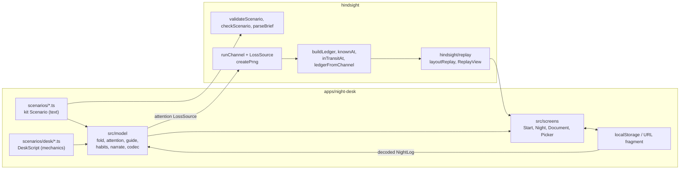
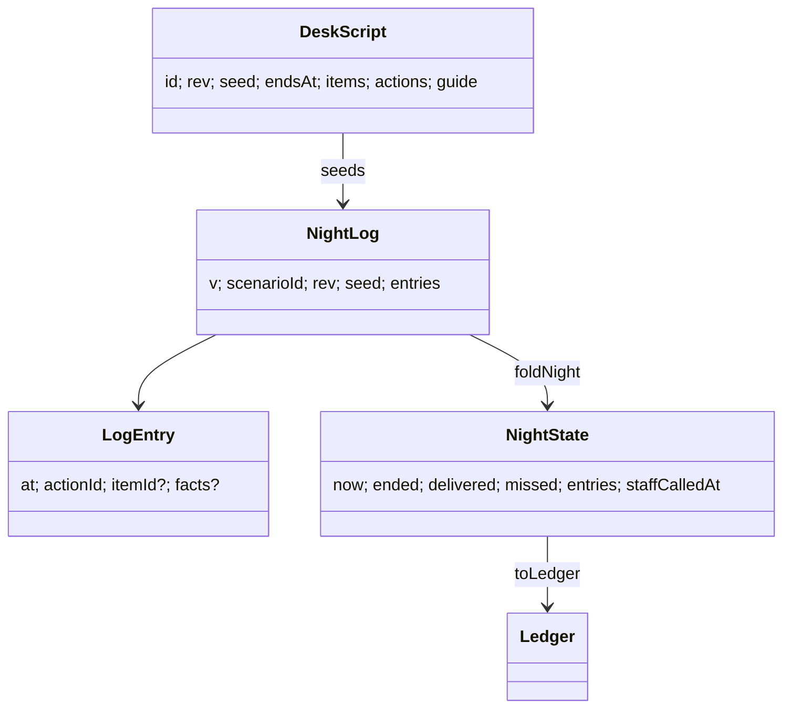

# Design: Night Desk

## Overview

Night Desk is a one-player drill built on the Hindsight kit. The player is a resident assistant (RA) on a fictional duty night. Things arrive from five sources (duty phone, door, floor group chat, handoff note, message from the staff member on call). Every action costs simulated minutes, and while the player is busy or away, arriving items are queued, expire or are missed. The kit's lossy channel models this: **the `LossSource` is the player's attention**. At the end, the kit's replay shows what had reached the player at each decision.

This document designs the app only: `apps/night-desk/src` and `apps/night-desk/scenarios`. Nothing here changes the kit. The app imports the kit by the two package names `hindsight` and `hindsight/replay`, and copies none of its code.

### What exists today (read before designing)

| Fact | Source | Consequence for this design |
|---|---|---|
| The kit exports `runChannel(seed, loss, sends)`, `LossSource.assess(send, prng)`, `createPrng`, `createClock`, `buildLedger`, `knownAt`, `inTransitAt`, `ledgerFromChannel`, `replayChannelLog`, `validateScenario`, `checkScenario`, `parseBrief`; and from `hindsight/replay` `layoutReplay` and `ReplayView({ ledger, scenario })`. | `packages/hindsight/src/index.ts`, `src/replay/index.ts` | The attention model needs no kit change. |
| A `LossSource` may read outside state as long as that state is deterministic. | doc block above `Impairment` in `channel/channel.ts` | The attention source closes over busy intervals derived from the player's log. |
| `runChannel` marks any two sends whose airtime overlaps as a `collision`. Airtime of 0 or less is clamped to `DEFAULT_AIRTIME` (1). Two sends at the same minute therefore always collide. | `channel/channel.ts` `airtimeOf`, `overlaps` | Night Desk items need distinct arrival minutes. A scenario test enforces it. A `collision` outcome is a bug in Night Desk and throws. |
| A dropped send emits no event, and `inTransitAt` keeps it "in transit" forever. | README, ledger | A missed item is simply a send with no outcome. The replay shows it as a line that never arrived, which is the design language's "absence". |
| `layoutReplay` draws one row per participant in `scenario.roles`, with decision ticks from `scenario.events` of type `decision` with an `actor`, and knowledge ticks from the ledger. | `replay/layout.ts` | The app builds a kit `Scenario` for the replay by adding one `decision` event per player action. |
| `scenarios.test.ts` in `apps/night-desk/scenarios` runs `validateScenario` and `checkScenario` on **every export of every `./*.ts` file** in that folder. | `apps/night-desk/scenarios/scenarios.test.ts` | Files directly in `scenarios/` export only kit `Scenario` values. Night Desk mechanics live in `scenarios/desk/` (not matched by the glob). |
| The brief grammar carries title, participants, beats and decisions only. It cannot carry `simulationNotice`, `summary`, event ids, `linkedTo` or `discussionPrompts`, or any Night Desk mechanics. | `docs/scenario-brief.md`, `RESULTS.md` (5.3) | A scenario file is written from the brief by the hook or by hand and then completed. The mechanics file is always written by hand against the brief. |
| `.kiro/specs/seance-replay/design.md` is **empty** (0 lines); only its requirements exist. The kit's `ReplayView` today is a minimal shell (one focusable row per participant, marks as shapes, no selection, no scrubber). | repository | Night Desk depends only on the props `{ ledger, scenario }`. Everything richer (selection, dimming, scrubber, counterfactual, discussion prompts) belongs to `seance-replay` and is not designed here. |
| No IBM Plex font files and no OFL licence file are in the repository. | `RESULTS.md` (6.1), file search | A later task (6.1) adds them. Until then the CSS names Plex first in a system font stack. |
| `apps/night-desk` has a shell: placeholder `main.tsx`, Vite `base` `/night-desk/`, Vitest `environment: "node"`, `include` for `src` and `scenarios`, 4 tests (smoke, example brief). It has no Testing Library or jsdom. `apps/dead-air` already uses `@testing-library/react`, `@testing-library/user-event`, `@testing-library/jest-dom` and `jsdom`. | `apps/night-desk/*`, `apps/dead-air/package.json` | Task 1.3 adds the same dev dependencies (already in the workspace) and a per-file jsdom docblock, the way Dead Air does. |

### Design decisions

1. **The event log is the only state.** A `NightLog` (scenario id, revision, seed, ordered entries) is persisted, shared and replayed. `NightState` is a pure fold of `(script, log)`. React state holds only UI choices (focus, open panel), never game facts.
2. **Time is derived, not stored twice.** Each entry stores its start time `at` for the log and for sharing, and the fold checks `at` equals the running clock. A mismatch rejects the log. Time therefore cannot go backwards in a valid log.
3. **Attention is a `LossSource`, rebuilt from the log.** For every non-collided send the source decides: deliver now, queue until the end of the covering action, or drop. It always draws one `prng.nextFloat()` per send, whatever it decides, so the draw order depends only on the sends.
4. **Prefix stability.** A send at minute `s` is assessed only when the clock `now >= s`. The busy interval of an action is the **open** interval `(at, at + cost)`. A send exactly at an action's start or end is not covered by it. Hence every interval that can cover `s` is known once `now >= s`, and re-running `runChannel` over the sends with `sendTime <= now` gives the same outcomes for earlier sends (the draw order is by `sendTime`, so a longer run only appends draws). This is what lets the fold re-run from scratch on every action and still be deterministic and incremental in effect.
5. **Mechanics are data.** The script says what each action costs and whether it is `desk`, `busy` or `away`. The engine contains no scenario words.
6. **Scenarios are fiction, scripted, and checked twice.** The kit validates the `Scenario` (shape, reachability, ends). Night Desk's own tests validate the mechanics file against it (ids match, minutes distinct, call-staff action present) and scan text for out-of-scope topics.
7. **No new runtime dependency.** React and the kit only. Dev dependencies are the ones Dead Air already uses.

## Architecture



Data flows one way. The player acts in a screen, the screen appends an entry to the `NightLog`, the fold produces a new `NightState`, and the screen renders it. At the end of the night, the same log feeds `toLedger` and `toReplayScenario`, which feed the kit's replay.

### Folder layout (all inside the app)

```
apps/night-desk/
  scenarios/                    only kit Scenario exports (the shared test globs ./*.ts)
    guided-first-night.ts
    loud-music-harlow-3.ts      (later tasks add the other nights)
    briefs/*.md
    desk/                       mechanics, one DeskScript per night (default export)
      guided-first-night.ts
      desk.test.ts              cross-checks every desk file against its scenario
      content.test.ts           out-of-scope word scan over briefs and scenario text
  src/
    main.tsx                    mounts <App/>
    App.tsx                     screen state machine
    nights.ts                   registry built with import.meta.glob over scenarios and desk
    model/
      types.ts                  DeskScript, ItemDef, ActionDef, NightLog, NightState
      attention.ts              attentionLoss(script, intervals): LossSource
      night.ts                  foldNight, availableActions, applyAction, endsAt
      guide.ts                  currentStep(script, state)
      replay-input.ts           toLedger, toReplayScenario
      habits.ts                 three plain figures
      narrate.ts                summary and per-decision sentences
      codec.ts                  encodeLog, decodeLog (JSON, base64url)
      storage.ts                load, save, clear (localStorage, never throws)
      picker.ts                 filterNights
      clock-format.ts           minutes since midnight to "11:10 pm"
    screens/ Start.tsx, Night.tsx, Document.tsx, Picker.tsx
    voice/voice.ts              optional clip playback gated by a gesture
    styles.css                  tokens from design-language.md
    test-setup.ts               jest-dom matchers
```

Imports inside the app stay relative and inside the app. `scenarios/` and `src/` import the kit only as `hindsight` and `hindsight/replay`, which `pnpm check:boundaries` enforces.

## Components and Interfaces

### Scenario files and mechanics files

A night is two files with the same base name.

1. `scenarios/<id>.ts` exports one kit `Scenario`. Roles are `ra` (the player) plus the sources used by the night (`phone`, `door`, `chat`, `note`, `staff`). Each item is a `message_created` event; its `title` and `body` are the item's text (for a voice clip, the body is the transcript). `decisionPrompts.ra.options` lists the night's actions, so the kit's `decisions-have-options` check is meaningful. A final `debrief` event ends the night.
2. `scenarios/desk/<id>.ts` default-exports a `DeskScript`:

```ts
type SourceId = "phone" | "door" | "chat" | "note" | "staff";
type Attention = "desk" | "busy" | "away";
type ActionKind = "respond" | "go" | "callStaff" | "log" | "wait";

interface ItemDef {
  id: string;                 // equals the id of a message_created event in the Scenario
  source: SourceId;           // sender in the channel; recipient is always "ra"
  at: number;                 // arrival minute; distinct across the script
  kind: "call" | "knock" | "message" | "note";
  expiresAfter?: number;      // drop if it would wait longer than this many minutes
  lapse?: number;             // 0..1, chance a busy player misses a phone item
  needsProfessional?: true;   // a moment the scenario marks (Req 2.4)
  voice?: { file: string };   // optional clip under public/voice/
}

interface ActionDef {
  id: string;
  label: string;
  key: string;                // single character, unique per script
  kind: ActionKind;
  cost: number;               // integer minutes >= 1
  attention: Attention;       // desk: items arrive at once; busy: queue; away: phone and door lost
  requires?: string;          // item id that must have reached the player
  once?: true;
}

interface GuideStep {
  id: string;
  text: string;               // one instruction
  done: { actionId?: string; kind?: ActionKind };
}

interface DeskScript {
  id: string;                 // equals Scenario.id
  rev: number;                // bumped when the script changes; carried by logs and links
  seed: number;               // uint32
  order: number;              // position in the picker
  startClock: number;         // minutes after midnight, for display only
  endsAt: number;             // the night ends when the clock reaches this minute
  guided?: true;
  items: ItemDef[];
  actions: ActionDef[];
  guide?: GuideStep[];
  tags: string[];             // for the picker filters
}
```

`callStaff` is a script-level obligation: every script has at least one action of kind `callStaff` with no `requires` and `attention: "busy"`. It is therefore offered in every state of every night (Req 2.4), and `desk.test.ts` checks that. Items marked `needsProfessional` add one plain line next to the item ("The staff member on call is a phone call away."). The action is never applied by the engine and never hidden by it.

### Attention model

```ts
interface Interval { start: number; end: number; attention: Attention }   // open: (start, end)

function intervalsFromLog(script: DeskScript, log: NightLog): Interval[];
function attentionLoss(script: DeskScript, intervals: readonly Interval[]): LossSource;
```

`attentionLoss(...).assess(send, prng)` looks up the interval that strictly covers `send.sendTime` and returns an `Impairment`:

| Situation | Result |
|---|---|
| No covering interval, or covering action is `desk` | `dropped: false, delay: 0` (reaches the player at once) |
| Covering action is `busy`, item is a phone item with `lapse`, and `prng.nextFloat() < lapse` | `dropped: true` (missed) |
| Covering action is `busy` or `away`, other cases | `delay = interval.end - sendTime` (queued until the action ends) |
| Covering action is `away` and the item's source is `phone` or `door` | `dropped: true` (not delivered while away) |
| Queue wait would exceed `item.expiresAfter` | `dropped: true` (expired) |

One `prng.nextFloat()` is drawn for every send before any branch, so the stream position depends only on the number of sends. `payload` is the sent payload and `corrupted` is always `false`: Night Desk loses and delays items, it never garbles them.

### Night fold

```ts
interface NightLog {
  v: 1;
  scenarioId: string;
  rev: number;
  seed: number;
  entries: LogEntry[];
}
interface LogEntry { at: number; actionId: string; itemId?: string; facts?: string[] }

interface DeliveredItem { id: string; source: SourceId; sentAt: number; deliveredAt: number }
interface MissedItem   { id: string; source: SourceId; sentAt: number; reason: "away" | "lapse" | "expired"; label: string }

interface NightState {
  now: number;
  ended: boolean;
  delivered: DeliveredItem[];     // ordered by deliveredAt, then id
  missed: MissedItem[];           // label and time only; the body is never included
  entries: LogEntry[];
  staffCalledAt: number | null;
}

function foldNight(script: DeskScript, log: NightLog): Result<NightState, LogError>;
function availableActions(script: DeskScript, state: NightState): ActionDef[];
function applyAction(script: DeskScript, log: NightLog, actionId: string, opts?: { itemId?: string; facts?: string[] }): Result<NightLog, LogError>;
```

`foldNight` walks the entries, keeping a running `now` that starts at 0 and advances by each action's `cost`. For each entry it checks, in this order: the action exists; `entry.at === now`; the night has not ended; `requires` has been delivered (by the fold so far); `once` actions are not repeated; any `facts` are ids of delivered items. Then it builds `intervals`, sends (`id`, `sender = source`, `recipient = "ra"`, `sendTime = at`, a one-byte payload) for every item with `at <= now`, and calls `runChannel(seed, attentionLoss(script, intervals), sends)`. A `collision` outcome throws a programming error. A `received` outcome yields a `DeliveredItem` if `simTime <= now`. A send with no outcome and `at <= now` yields a `MissedItem` with the reason the source recorded. The reason is recovered by calling the same rules again over the intervals (`explainMiss`), not by a second state.

`foldNight` returns a typed error instead of throwing for any log problem, so a corrupt stored log or a bad link cannot crash the app.

`applyAction` appends `{ at: state.now, ... }` and re-folds. It is the only writer of the log.

### Replay input

```ts
function toLedger(script: DeskScript, log: NightLog): Ledger;
function toReplayScenario(scenario: Scenario, script: DeskScript, state: NightState): Scenario;
```

`toLedger` rebuilds sends for all items with `at < endsAt`, runs the same channel, and returns `buildLedger(ledgerFromChannel(sends, replayChannelLog(events)))`. `toReplayScenario` returns a copy of the night's `Scenario` with one extra event per entry: `{ id: "d<n>", type: "decision", simTime: entry.at, audience: "ra", actor: "ra", title: <action label>, body: "" }`. Neither function mutates its input.

### Guide

`currentStep(script, state)` returns the first `GuideStep` whose `done` condition no entry satisfies, or `null`. Guidance is shown only when `script.guided` is set, one step at a time, with a thin progress line (`done / total`). A step disappears the moment its action is taken, so "shown only until the player has done that thing once" holds without any stored flag.

### Habits and narration (pure, app-side)

```ts
interface Habits {
  acknowledgement: { meanMinutes: number | null; longestMinutes: number | null; unacknowledged: number };
  written: { known: number; written: number; unwritten: string[] };   // fact ids
  professional: { minutes: number | null; moments: number };          // minutes null with moments > 0 means no call was made
}
function habits(script: DeskScript, state: NightState): Habits;
function narrate(scenario: Scenario, script: DeskScript, log: NightLog, state: NightState, ledger: Ledger): { summary: string; decisions: string[] };
```

These live in the app, not the kit, because their words ("acknowledgement", "staff member") are app-specific and the kit forbids app words. `seance-replay` Req 5 defines different habits for Dead Air (transmissions, collisions); the two sets do not overlap and are not shared.

- **Acknowledgement** for an item is `first entry with itemId === item.id` minus `deliveredAt`. An action acknowledges the item it `requires`, or the item passed in `opts.itemId`.
- **Written vs known**: `known` is the number of delivered items; `written` is the number of distinct fact ids across `log` entries.
- **Professional**: `moments` is the number of `needsProfessional` items in the script. For the earliest of them, minutes from its `deliveredAt` (its `at` if it was missed) to the first `callStaff` entry at or after it; `null` with `moments > 0` renders "No call was made."; `moments === 0` renders "This night had no such moment."
- Each figure is paired with one fixed line saying why it matters. No score, no total, no colour.

`narrate` uses the kit: for each decision at time `t` it reads `knownAt(ledger, "ra", t)` and `inTransitAt(ledger, "ra", t)`, and splits the in-transit set into "still on its way" (a later `received` outcome exists) and "missed" (none ever). It states facts only ("By 11:24 you had the text from Priya and the knock. A call from the duty phone at 11:19 was missed.") and never what the player should have done (seance-replay Req 3.2).

### Codec and persistence

```ts
function encodeLog(log: NightLog): string;                 // base64url of UTF-8 JSON
function decodeLog(token: string): Result<NightLog, CodecError>;
function loadSaved(storage: Storage | undefined): NightLog | null;
function save(storage: Storage | undefined, log: NightLog): void;   // never throws
```

- **Storage**: one key, `night-desk:v1:log`, holds `encodeLog(log)` for the night in progress or just finished. `night-desk:v1:completed` holds the ids of finished nights. Both operations catch any `Storage` error (private mode, quota) and the app continues without saving.
- **Share link**: `<origin>/night-desk/#r=<token>`. The fragment never reaches a server. On load, a valid `#r=` token takes precedence over storage and opens the replay document directly; it does not overwrite the visitor's own saved night.
- **Validation on every load**: `decodeLog` checks shape; `App` looks up the scenario by id; `rev` must equal the script's `rev`; `foldNight` must succeed. Any failure shows one plain sentence ("This link was made for an older version of this night" or "This link could not be read") and the start screen.
- A typical log is 10 to 25 entries and the token is a few hundred characters, so no compression is used.

### Screens

| Screen | Content | Keys |
|---|---|---|
| **Start** (Req 1.1) | One sentence naming who it is for, the practice line, one button. Nothing else. | `Enter` activates the button, which has initial focus. |
| **Night** (Req 2.1, 6.1) | Header: the clock and the progress line (guided only). Left: items that have reached the player, newest first, each with source, time sent, time it reached the player when different, and its text. A line "Missed: call at 11:19" per missed item. Right: the action list, each with its key. The guided instruction sits above the actions. Sound control and a mute state, always visible. | One key per action (digits for night-specific actions, `W` wait, `C` call the staff member, `L` log). Visible focus. |
| **Document** (Req 4.1 to 4.4) | Heading, one-paragraph summary, the kit's `ReplayView`, one sentence per decision, the three habits, then "Play it again", "Choose another night", "Copy link". | Standard tab order. |
| **Picker** (Req 5.3) | List of nights; a search field and tag filters appear only when more than seven nights exist. | Type to filter. |

The screen state machine is `start -> night -> document`, with `picker` and `invalid-link` side screens. The night screen has no scrolling at 1280x720: the layout is two columns sized to the viewport and the item list scrolls inside its own region only if more than about eight items are visible (an accepted limit, recorded in `docs/RESULTS.md`).

### Voice (optional)

`voice.ts` exposes `createVoice(factory, now)`. It plays a clip only if `item.voice` exists, a user gesture has occurred (`pointerdown` or `keydown` seen), and sound is not muted. The transcript is the item's text, which is always on screen. With no clips the module is inert. Generating voice clips, the `MANIFEST.md` naming a model, licence and date, and any `public/voice/` files are **out of scope for the first tasks**; the task list contains only the playback layer.

### Style

Tokens come from `.kiro/steering/design-language.md`: paper `#F5F2EA`, ink `#1A1916`, greys `#6B6861`, `#A9A59B`, `#DDD9CF`, accent `#9A3B26` only for loss (a missed item). A missed item is therefore the only place colour appears. Radius is 2 px on controls and 0 on surfaces. State changes are instant. `prefers-reduced-motion` sets every transition to `none`. Until task 6.1 the font stack names IBM Plex first and falls back to system fonts.

## Data Models



**Item life cycle.** An item has exactly one of these outcomes by the end of the night: delivered at `deliveredAt >= sentAt` (immediately or at the end of the covering action), or missed with reason `away`, `lapse` or `expired`. An item that arrives after `now` has no state yet.

**Worked example.** An item `i2` (phone call, `at: 8`) and the action `go` (`away`, cost 6) taken at `now = 5` cover `(5, 11)`. `i2` is a phone item inside an away interval, so it is dropped. The state after the action has `now = 11`, no `i2` in `delivered`, and `i2` in `missed` with reason `away`, label "Missed call", time 8. An item `i3` (chat message, `at: 9`) in the same interval is queued: `deliveredAt = 11`.

**Log example** (guided night, three entries):

```json
{ "v": 1, "scenarioId": "guided-first-night", "rev": 1, "seed": 4101,
  "entries": [
    { "at": 0, "actionId": "read-text", "itemId": "i1" },
    { "at": 3, "actionId": "wait" },
    { "at": 6, "actionId": "answer-door", "itemId": "i3" } ] }
```

## Correctness Properties

*A property is a characteristic or behavior that should hold true across all valid executions of a system-essentially, a formal statement about what the system should do. Properties serve as the bridge between human-readable specifications and machine-verifiable correctness guarantees.*

Prework reflection. These were merged: 2.2 "time never backwards" and "log entries record the clock" into Property 1; 2.2 "delivered at most once", "queued" and "expired" into Property 2; 2.4 into Property 4 (reachable states, not a separate example); 6.3 reload and 4.4 share link into one codec round trip, Property 7, because they use the same encoder; 5.4 determinism is separate (Property 6) because it covers the fold and the replay layout, not the codec. UI requirements (1.1, 1.3, 2.1, 2.6, 3.1, 3.2, 4.1, 6.1, 6.2) are examples or manual checks and have no property.

### Property 1: Time never goes backwards

*For any* night script and *any* sequence of valid actions, the clock after each action equals the clock before it plus that action's cost, every entry's `at` equals the clock before it, and the sequence of `at` values is strictly increasing. A log whose `at` disagrees with the running clock is rejected.

**Validates: Requirements 2.2**

### Property 2: An item is delivered at most once, and only when the rules allow

*For any* night script and *any* sequence of valid actions, no item id appears twice in `delivered`; every `deliveredAt` is at least the item's `sentAt`; an item that arrived during a `busy` or `away` action and was not dropped has `deliveredAt` equal to the end of that action; an item whose queue wait would exceed its `expiresAfter` is never in `delivered`; and every item with `at <= now` is in exactly one of `delivered` or `missed`.

**Validates: Requirements 2.2**

### Property 3: Away blocks the phone and the door, and a missed item shows time, not content

*For any* night script and *any* sequence of valid actions, no item with source `phone` or `door` whose arrival minute lies inside the open interval of an `away` action is in `delivered`; each such item is in `missed` with its arrival minute and a label; and no field of a `MissedItem` equals or contains the item's body text.

**Validates: Requirements 2.3**

### Property 4: The staff member on call is always offered and never forced

*For any* night script and *any* reachable state of a night in progress (any prefix of any valid action sequence that has not reached `endsAt`; a finished night offers no actions at all), `availableActions` contains an action of kind `callStaff`; and for any log that contains no `callStaff` entry, `foldNight` yields `staffCalledAt === null` (the fold never inserts the call).

**Validates: Requirements 2.4**

### Property 5: A log entry records known facts and the current time

*For any* reachable state and *any* subset of the delivered item ids, a `log` action with that subset is accepted and the new entry has `at` equal to the clock before it and `facts` equal to the subset; *for any* fact id not in `delivered`, the action is rejected and the log is unchanged.

**Validates: Requirements 2.5**

### Property 6: Same scenario and same choices give the same replay

*For any* night script and *any* sequence of valid actions, folding the same log twice, and folding a log rebuilt from the same sequence of `applyAction` calls, give deeply equal `NightState`, equal `Ledger` from `toLedger`, and equal `ReplayLayout` from `layoutReplay`.

**Validates: Requirements 5.4**

### Property 7: The log codec round-trips and restores the same night

*For any* valid log of *any* night, `decodeLog(encodeLog(log))` equals the log; and `foldNight` of the decoded log equals `foldNight` of the original; and a log saved with `save` and read with `loadSaved` from a fake `Storage` folds to the same state as the log before saving. *For any* string that is not a valid token, `decodeLog` returns an error and does not throw.

**Validates: Requirements 4.4, 6.3**

### Property 8: Habit figures are a pure function of the log and are never negative

*For any* night script and *any* valid log, `habits` called twice gives equal results; every minute figure is a non-negative integer or `null`; `unacknowledged` is at most the number of delivered items; `written` is at most `known`; and when the night has a `needsProfessional` item and no `callStaff` entry, `professional.minutes` is `null` and `professional.moments` is greater than 0.

**Validates: Requirements 4.3**

### Property 9: The replay text has one sentence per decision

*For any* night script and *any* valid log, `narrate` returns exactly one decision sentence per log entry, and each sentence contains the clock text of its entry; the sentences name every item delivered by that time and none delivered later; and no sentence contains the words "should have", "mistake" or "correct".

**Validates: Requirements 4.2**

### Property 10: The picker filter returns only matching nights, in order

*For any* list of nights and *any* query string, `filterNights` returns a subsequence of the input in its original order, every returned night contains the query (case-insensitive, trimmed) in its title or tags, and an empty query returns the whole list.

**Validates: Requirements 5.3**

## Error Handling

| Situation | Behaviour |
|---|---|
| Action not available (unmet `requires`, repeated `once`, night ended) | `applyAction` returns an error and leaves the log unchanged. The UI only offers available actions, so a user cannot reach this by clicking; the check protects keys and tests. |
| A `log` action names a fact not yet delivered | Rejected; the log is unchanged. |
| Stored log fails to decode, fold, or has an old `rev` | The saved night is cleared; the start screen shows. One plain sentence names the problem for a link; a silent reset for storage. |
| **Override (2026-11-23), replaces the row above for stored saves** | A save that is unreadable, unsupported, from another `rev` or fails `foldNight` is kept untouched and never cleared automatically. One plain sentence names the reason and the start screen shows. The new night is held in memory and not saved while that save exists. `clear()` is called only by the "Discard the saved night" button. `loadSaved` therefore returns `none`, `storage-error`, `resume` or `unusable` (with a reason), not a bare log. A throwing `Storage` continues the night in memory with one line saying so. Same rule as Dead Air's RunHost. |
| `#r=` token is malformed, too long (over 8 KB), or names an unknown night | `decodeLog` or the lookup returns an error; the app shows "This link could not be read" and the start screen. No exception reaches the page. |
| `localStorage` unavailable or throws | The app continues without saving. Reload then starts fresh. |
| A scenario file or desk file is invalid | Caught by tests, never at runtime: `validateScenario`, `checkScenario`, `desk.test.ts` and `content.test.ts` run in `pnpm test`. |
| The channel returns a `collision` outcome | Programming error: `foldNight` throws a clear message naming the item, which `desk.test.ts` prevents by requiring distinct arrival minutes. |
| An audio clip fails to load or play | Swallowed. The transcript is already on screen, so nothing is lost. |
| A shared link is opened on a build with a different `rev` | The "older version" sentence above. Nights are never migrated. |

## Testing Strategy

**Property-based tests apply** to the pure model: the fold, attention rules, codec, habits, narration and filter. UI rendering and layout do not get property tests; they get Testing Library tests through visible text and roles (`.kiro/steering/testing.md`), plus manual checks.

- **Libraries and configuration.** Vitest and `fast-check` (already a dev dependency). Each property is one test in `x.prop.test.ts` beside its code, runs at least 100 runs, and carries a comment `// Feature: night-desk, Property N: <text>`. A failing seed is printed in CI output; once fixed, the counterexample is pasted into an example test.
- **Generators.** An arbitrary valid action sequence is built by repeatedly choosing among `availableActions` for a given script (so every sequence is valid by construction), with random item ids and random subsets of delivered items for log facts. Scripts used are the shipped nights plus one synthetic script with every mechanic (desk, busy, away, queue, expiry, lapse).
- **Unit and example tests** pin behaviour a person would describe: the start screen text; the guide shows one instruction and drops it after the action; a phone call during an away action appears as "Missed call" with its time; "call the staff member" is on screen on every night screen; the whole first-night flow in jsdom through visible text (task 1.3); reload restores; the link opens the same replay; nothing plays before a gesture.
- **Scenario tests.** `scenarios.test.ts` (existing) runs `validateScenario` and `checkScenario` on every scenario file. `desk.test.ts` checks, for every desk file: same id as its scenario; every item id is a `message_created` event; arrival minutes are distinct integers below `endsAt`; keys unique; costs integers of at least 1; a `callStaff` action with no `requires`; `requires` and guide references exist. `content.test.ts` scans briefs and scenario text for out-of-scope words (self-harm, sexual misconduct, medical emergency and weapons vocabulary, plus real-institution markers). This scan is a heuristic and does not replace a human read.
- **Manual checks (not automated, recorded in `docs/RESULTS.md` with the date and what was observed).** First meaningful choice within 60 seconds (Req 1.3); a night finishes within 8 real minutes for a first-time player (Req 2.6); one screen without scrolling at 1280x720 (Req 2.1); visible focus and key hints by keyboard only (Req 6.1); reduced motion (Req 6.2); WCAG AA contrast in both appearances; one screen-reader pass of the document page. A manual check is never reported as passed until someone has done it.
- **Gate for every task.** At the repository root `pnpm typecheck`, `pnpm test`, `pnpm build` and `pnpm check:boundaries` exit 0, and the total test count is at or above the previous task's count.

## Assumptions and Open Questions

Assumptions made in this design (change them here if wrong):

1. **Item arrival while `desk`.** A `desk` action (wait, read) leaves the player at the desk, so items arrive at once. `busy` (writing a log, a call to the staff member) queues items to the end of the action. `away` (walking to a room) loses phone and door items and queues the rest. The requirements fix only the away rule.
2. **Door misses are shown like missed calls** ("Someone knocked at 11:42"), time only.
3. **The staff call is offered at every moment**, not only at marked ones. This satisfies "always offer" and "not hide" in Req 2.4 in the strictest reading. The marked moments add one plain line beside the item.
4. **Return visitors.** `Start` begins the guided night until it has been completed once on this device, and opens the picker afterwards. Req 1.2 says "first run"; this is the reading used.
5. **Item text doubles as the transcript.** One string per item, no separate transcript field.
6. **Four nights are enough for the picker to be hidden.** The search field is built and tested but invisible until a list has more than seven nights, so users never see it in the submitted build unless nights are added.
7. **Seed.** One fixed seed per night, stored in the log. There is no per-play random seed, because "same scenario, same choices" is the requirement and a replayed night should feel the same.

Open questions for the developer:

- **`seance-replay` has no design yet.** Night Desk's document page composes the kit's `ReplayView` today. When `seance-replay` lands richer behaviour (selection, scrubber, counterfactual, discussion prompts, a print layout), only `Document.tsx` changes. Do you want Night Desk to wait for that, or ship with the minimal view? The plan assumes it ships first.
- **`⌘K` command list** is in the design language but not in the Night Desk requirements. It is **not** in this plan. Say so if it should be.
- **Fonts for Night Desk and Dead Air.** The plan places a copy under `apps/night-desk/public/fonts/` with its own OFL file. A shared location would have to go through `site/`. Which do you prefer?
- **Share link size and privacy.** The link holds only action ids and minutes, no free text, so it carries nothing personal. Confirm that no free-text field will ever be added to a log entry.
- **Content review.** The out-of-scope word scan cannot prove a night is safe. A human reads each night before it ships; who does that, and when?
- **Dependency check.** No new runtime dependency is planned. Testing Library, jest-dom and jsdom are added as dev dependencies of `apps/night-desk` with the versions Dead Air already uses.
