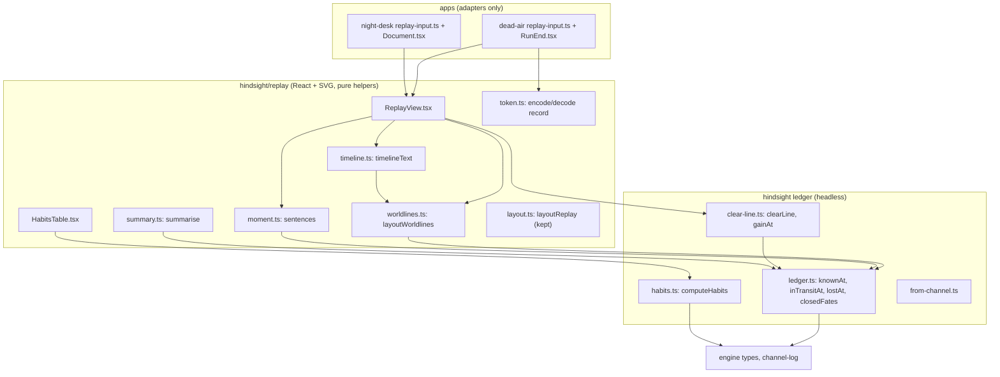

# Design: seance-replay (the replay)

Written from `requirements.md` (approved, unchanged) and the code as it is today. This design covers the kit's knowledge functions (`packages/hindsight/src/ledger/`), the pure layout and the view (`packages/hindsight/src/replay/`, entry `hindsight/replay`), and the small adapter changes in both apps. It writes no code.

## Overview

The replay turns the event log into a worldline diagram: one vertical ink line per participant, time flowing down, every message a thin diagonal from its send point on the sender's line to its arrival point on the receiver's. Slope encodes delay. A message that never arrived is a line in the loss colour that stops short. Selecting a decision fades everything that participant did not yet know.

### What exists today (read before designing)

| Fact | Source | Consequence for this design |
|---|---|---|
| `ReplayView({ ledger, scenario })` draws one horizontal row per participant with circle and square marks. No signals, no time axis, no selection. | `replay/ReplayView.tsx` | The view is rebuilt around worldlines. Its two props keep working; new props are optional (see Compatibility). |
| `layoutReplay(ledger, scenario)` returns rows of ticks, not geometry. Both apps' tests call it. | `replay/layout.ts`, `night-desk/.../replay-input.test.ts` | It stays exported and unchanged. A new function, `layoutWorldlines`, returns geometry. |
| A `LedgerEvent` is `learned`, `sent` or `outcome` (`received`, `garbled`, `collision`). A dropped message has no outcome. An outcome with no `sent` event is never known (`orphanOutcomes`). | `ledger/ledger.ts` | The ledger cannot represent "this arrived and I do not know when it was sent". A new `arrival` event kind is added. |
| `knownAt` finds the recipient through the `sent` event. `inTransitAt` keeps a dropped message in transit forever. Garbled and collided messages are neither known nor in transit. | `ledger/ledger.ts` | A new `lostAt` names the third group. "Never arrived" is a property of a closed record, not of a moment. |
| Dead Air's adapter invents a send at the arrival time for every outcome it cannot match to a send, and calls the message "Message n from X". | `dead-air/.../replay-input.ts` | That is a made-up send time. The adapter stops inventing it and emits an `arrival` instead. |
| In Dead Air Two tabs and acoustic modes the partner's sends happen on another device. Their sends are not logged and their drops leave no trace. In Solo the partner's schedule is logged. Runs saved before `send` entries existed have outcomes only. | `RESULTS.md` "Replay sends"; `replay-input.ts` header | The knowledge limit is real and differs by mode and by save. It must be passed as data. |
| Night Desk builds a `sent` event for every item (source to `ra`); a missed item is a send with no outcome. Its roles are `ra` plus four sources. | `night-desk/src/model/replay-input.ts` | Sources are participants of kind `source`. Their history is complete. Missed items become never-arrived lines at once. |
| `ReplayView.test.tsx` expects an element with role `list`, one `listitem` per participant with `tabindex` 0 and `aria-label` "Participant 2: 1 marks". `entries.test.ts` pins the replay entry's export list to `["ReplayView", "layoutReplay"]`. `core-headless.test.ts` pins the core export list. | kit tests | New exports update those two lists on purpose. The list structure stays through phase A (see Compatibility). |
| `check:boundaries` forbids, in the kit, the words resident, booth, modem, tower, night desk, dead air, fsk, acoustic; `Math.random`; `Date.now`; and, for the core entry, React and DOM globals. Folder direction: `replay -> ledger -> engine`. | `scripts/boundaries/check.mjs` | Limit and habit wording is written without those words. Habits and the token codec contain no DOM. |
| `night-desk` plans habits, narration (3.2, 3.3) and a `NightLog` codec (4.1) for itself. Its design says it uses `ReplayView` "through its props `{ ledger, scenario }` only". | `night-desk/tasks.md` | See Ownership. |

### Design decisions

1. **Geometry is a pure function; the view only draws it.** `layoutWorldlines(input, options)` returns plain numbers and strings. Tests assert on that data. There are no image snapshots (`testing.md`).
2. **The knowledge limit is typed data per participant.** `history: "complete" | "arrivals-only"`. The layout enforces it. It never invents a send time or a lost line for an arrivals-only sender, even if the caller also hands it a `sent` event.
3. **The kit holds generic limit wording.** Two sentences, filled in with the participant's label only. Callers may add one optional sentence of their own for the reason. Justified under "Provenance and the knowledge limit".
4. **One cursor drives everything.** A single `at: number | null` (null is the closed record; so is the last time when no participant is in focus) plus an optional `focus` participant. A selected decision sets both. The scrubber sets `at` and clears `focus`. Known sets, fade, in-transit clipping and the sentence are all functions of `(ledger, at, focus)`.
5. **Absence stays on the page.** A lost line is drawn, not removed. Under a cursor it is drawn only once its fate is settled by that moment.
6. **No colour except loss.** Weight and dash separate roles. Loss is `var(--loss, #9A3B26)`, always paired with a dotted stroke and a gap so it also reads in black and white.
7. **A document, not a dashboard.** Heading text comes from the caller. The view is a figure, a sentence panel, a scrubber, a collapsible text timeline, and optional sections. No chart other than the diagram.

## Architecture



Imports flow one way: `replay -> ledger -> engine`. Nothing in the kit imports from an app. Core entry gains only pure functions and types (no React, no DOM). The replay entry gains the view, the layout and the helpers.

### Data flow

1. The app builds a `Ledger` (as today) and a `participants` list (new), plus the `Scenario` that carries decisions, the title and discussion prompts.
2. `layoutWorldlines({ ledger, scenario, participants }, { at, focus, clearLine })` returns geometry, the limit notices, and a legend limited to the styles actually present.
3. `ReplayView` holds `at` and `focus` in React state, calls the layout, and draws. The sentence panel, the scrubber output and the text timeline come from pure functions over the same inputs.
4. Habits, the summary and the share token are separate pure functions; the view renders them only when the caller turns the section on.

## Components and Interfaces

### Provenance and the knowledge limit

```ts
// hindsight/replay
export type HistoryKnowledge = "complete" | "arrivals-only";

export interface ReplayParticipant {
  id: ParticipantId;
  label: string;
  /** "role" is a person who decides; "source" is something that only sends. Default "role". */
  kind?: "role" | "source";
  /**
   * "complete": every send by this participant is in the ledger, so a send that
   * has no outcome really never arrived.
   * "arrivals-only": only what reached someone is known. Send times and losses
   * on the way from this participant are not in the log. Default "complete".
   */
  history?: HistoryKnowledge;
  /** Optional app sentence saying why (for example "Their sends happen on another device."). */
  limitNote?: string;
}
```

What the layout does with `history`:

| Case | Drawn |
|---|---|
| Message has a `sent` event and the sender is `complete` | A signal: diagonal from the send point to the arrival point (or a lost line). |
| Message has a `sent` event, no outcome, sender `complete`, and the record is closed (`at` is null, or at or past the last time with no participant in focus) | A never-arrived line: loss colour, stops short, `spanIsDelay: false`. |
| Message has an `arrival` event (no send time) | An arrival mark on the receiver's line: a short horizontal tick toward the sender's side. No diagonal. Style: a solid 16 px ink tick with no end cap. A garbled or collided arrival uses a dotted tick in the loss colour. |
| A `sent` event whose sender is `arrivals-only` | Ignored for geometry. Its outcome, if any, is drawn as an arrival mark. The declared limit wins over the data, so nothing is drawn that the caller said cannot be known. |
| Sender has no entry in `participants` | Appended after the listed ones. `complete` if the ledger has a `sent` event from it, otherwise `arrivals-only`. |

The notice. For the arrivals-only participants that have at least one arrival, the layout returns one `KnowledgeLimit { participants, text }` and the view prints it once, in the figure caption, directly under the diagram, and nowhere else. Text, with labels joined by "and":

> Send times from {labels} are not in this log, so their arrivals are marks, not lines. Messages lost on the way from {labels} cannot appear.

Each participant's optional `limitNote` follows as its own sentence.

**Why the kit holds the wording and the caller supplies only the reason (Req 6.1).** Req 6.1 forbids scenario text, role names and wording specific to either app. These two sentences name only a label that the caller passes, and use no word on the boundary list. Holding them in the kit gives three things a caller-supplied sentence would not: both apps say the same true thing in the same words; a test in the kit can assert the sentence appears whenever an arrivals-only participant has arrivals and never otherwise; and an app cannot soften or drop the limit. The part that is app knowledge, why the history is missing, stays in the app as `limitNote`. The kit never says "device" or "tab" (that would name an app's modes).

### Participant styling (no second hue)

The layout assigns each worldline a style from its position among the roles. Sources do not count as roles.

| Role index | Weight | Dash |
|---|---|---|
| 0 | regular (1.5 px, label weight 400) | solid |
| 1 | medium (2.5 px, label weight 500) | dashed `6 4` |
| 2 | regular | dashed `2 3` |
| 3 | medium | solid |
| (cycles) | | |
| source | hairline 1 px, colour `#6B6861` | solid |

### Geometry

```ts
export interface WorldlineInput {
  ledger: Ledger;
  scenario: Scenario;                              // title, decision events, discussion prompts
  participants?: readonly ReplayParticipant[];     // default: scenario.roles as complete roles, then senders found in the ledger
  names?: Readonly<Record<string, string>>;        // optional id -> label for facts and messages
}
export interface LayoutOptions {
  at?: number | null;          // cursor; null, or at >= end with no focus, means the closed record
  focus?: ParticipantId | null;
  clearLine?: boolean;         // phase C
}
export const VIEW = { width: 840, height: 560, top: 56, bottom: 24, left: 64, right: 24, gap: 12, stub: 32, minLabelGap: 16 } as const;

export interface WorldlineLayout {
  view: { width: number; height: number };
  time: { start: number; end: number; top: number; bottom: number; ticks: readonly number[] };
  lines: readonly Worldline[];
  signals: readonly Signal[];
  arrivals: readonly ArrivalMark[];
  knowledge: readonly KnowledgeMark[];
  decisions: readonly DecisionNode[];
  limits: readonly KnowledgeLimit[];
  legend: readonly LegendKey[];
  skipped: readonly string[];   // ids left out of the geometry because the log contradicts itself
}
export function timeToY(time: WorldlineLayout["time"], t: number): number;
```

- **x.** Participants are spaced evenly between `left` and `width - right`, in the caller's order. The caller chooses the order (Night Desk puts the player first).
- **y.** `y(t) = top + (t - start) / (end - start || 1) * (height - top - bottom)`. `start` and `end` are the least and greatest sim-time over the ledger and the decisions. Time flows down. Ticks are 4 to 8 round values between them. Formatting a time is the caller's job (`formatTime`), because a minute after midnight and a millisecond are different things.
- **Signal** (a message with a known send):

```ts
export type Fate = "received" | "garbled" | "collision" | "never-arrived" | "in-transit";
export type Tone = "ink" | "loss" | "faded";
export interface Signal {
  id: string; from: ParticipantId; to: ParticipantId;
  x1: number; y1: number; x2: number; y2: number;   // y2 is clipped to y(at) while open
  fate: Fate;
  sentAt: number; arrivedAt: number | null;
  spanIsDelay: boolean;      // false for never-arrived stubs
  open: boolean;             // ends at the cursor, not at an arrival
  tone: Tone;
  dotted: boolean;           // lost lines
}
```

  - received: `(x1,y1)` on the sender's line, `(x2,y2)` on the receiver's; `y2 - y1 = scale * (arrivedAt - sentAt)`.
  - garbled or collision: same `y2`, but `x2` stops `VIEW.gap` short of the receiver's line. Vertical span is still the delay. Tone `loss`, dotted.
  - never-arrived: no arrival time exists, so no delay is drawn. The line runs a fixed `VIEW.stub` px down and half the way across, tone `loss`, dotted, `spanIsDelay: false`. The legend says a never-arrived line's length is not a delay.
  - **In transit at the cursor.** If `sentAt <= at` and the outcome is later than `at` (or absent and the record is not closed), the line is drawn along its full diagonal and cut at `y(at)`; `open: true`. For a message with no outcome the diagonal is the stub's slope, cut at the smaller of `y(at)` and the stub end. Nothing is drawn beyond the cursor.
  - **Not yet sent at the cursor.** Drawn whole, tone `faded`.
- **ArrivalMark** (arrival with no send time): `{ id, from, to, x, y, outcome, tone, dotted }` with `(x,y)` on the receiver's line at `y(arrivedAt)`.
- **KnowledgeMark** (a `learned` fact): a small circle on that participant's line.
- **DecisionNode**: `{ id, actor, x, y, labelX, labelY, label, selected }`. Labels sit beside the line and are spread with `declutter` so none is closer than `minLabelGap` px to another on the same side. The node stays at its true `y`.
- **Tone with a cursor.** With `at === null`, nothing is faded and every settled loss is red. With `at = t` and `focus = F`: an item is `ink` when F knew it at t (F's own sends sent at or before t; messages and facts in `knownAt(F, t)`); `loss` when its fate was settled as garbled or collision at or before t and it involves F; `faded` for everything else, including messages from another participant to F that are still on their way (F cannot know they exist). With `focus = null`, `faded` means "after t".

### Text for a moment

`moment.ts` (pure, replay folder):

```ts
export interface Missing {
  inTransit: readonly string[];   // addressed to F, sent by t, no outcome by t
  lost: readonly string[];        // addressed to F, garbled or collided by t
  elsewhere: readonly string[];   // known to another participant by t, not to F
}
export function missingAt(l: Ledger, f: ParticipantId, t: number): Missing;
export function momentSentences(input: WorldlineInput, f: ParticipantId, t: number, fmt: (t: number) => string): string[];
```

Sentences are plain facts: "At 11:10, Role A had 3 things: ..." (labels from the caller). "Not yet arrived: ..." "Lost on the way: ..." "Known elsewhere: ..." A participant with an arrivals-only counterpart gets no "not yet arrived" list for that counterpart's sends, because that list cannot be known (the limit text covers it). No sentence says what should have been done. Words such as should, ought, better, mistake, wrong and correct appear in no kit-owned template.

### The view

```ts
export interface ReplayViewProps {
  ledger: Ledger;
  scenario: Scenario;                                   // unchanged
  participants?: readonly ReplayParticipant[];          // new, optional
  names?: Readonly<Record<string, string>>;             // new, optional
  formatTime?: (t: number) => string;                   // new, optional; default String(t)
  at?: number | null;                                   // new: initial cursor (state is internal)
  sections?: { counterfactual?: boolean; prompts?: boolean; summary?: boolean; habits?: boolean; timeline?: boolean };
  shareUrl?: string;                                    // new, optional
  habitOptions?: HabitOptions;                          // new, optional
}
```

Structure, top to bottom:

1. `<figure>` with the SVG (viewBox 840 x 560, `width: 100%`) and a `<figcaption>` holding the one key line (only styles present) and the limit notice. At 1280 x 720 the figure takes 8 of 12 columns and the sentence panel takes 4, so the diagram is about 1:1.
2. Sentence panel beside it: with no cursor, the one-paragraph summary; with a cursor, `momentSentences`.
3. Scrubber: a native `<input type="range">` over `[start, end]`, with `aria-valuetext` set to the formatted time, and a visible output "At 11:10" or "End of the record".
4. Optional sections: "Clear line" toggle and the per-decision gains (phase C), discussion prompts and Copy summary and Copy link (phase D), habits table (phase E).
5. `<details>` "Text timeline" with an ordered list that carries every decision, signal, arrival and fact in time order.

Inside the SVG: worldline labels at the top (`<text>`, in the role's weight), time labels in IBM Plex Mono down the left gutter, decision nodes as 8 x 12 squares with a label, learned facts as circles. All text is real `<text>`, selectable (`user-select: text`, no `pointer-events: none`).

Keyboard. Decision nodes are `<g role="button" tabindex="0" aria-pressed>`. Enter or Space selects. Up and Down move between decisions in time order. Escape clears the selection. The scrubber is native, so arrow keys, Home and End work. The "Clear line" toggle is a button with `aria-pressed`. Focus is a 2 px ink outline. Under a cursor, items the role did not yet know are `faded`; the nodes and the text panel stay readable.

Motion. Opacity changes take 120 ms. Nothing moves, nothing loops. Under `prefers-reduced-motion: reduce` the opacity transition is also removed. The component's inline `<style>` contains no `animation` and no `transform` transition.

Print and theme. An inline `<style>` inside the figure holds a small `@media print` block: the figure avoids page breaks, the SVG scales to one page, loss lines print black and dotted, faded items print mid grey. Colours come from CSS custom properties with the light values as fallbacks (`var(--ink, #1A1916)`, `var(--paper, #F5F2EA)`, `var(--loss, #9A3B26)`, `var(--grey-1..3)`), so the apps' dark appearance applies without the kit knowing about it.

### Compatibility and migration

- `{ ledger, scenario }` alone still renders. `participants` is derived from `scenario.roles` plus any sender in the ledger, as `complete`. This is the old behaviour and is truthful only when the caller has every send.
- Phase A keeps the structure the existing kit test pins: the SVG is `role="list"` labelled "Replay: {title}", with one `role="listitem"` group per participant, `tabindex="0"`, labelled "{label}: {n} marks". Phase B replaces `listitem` focus with decision-node focus and updates that test on purpose, in the same task.
- `layoutReplay` stays. `ReplayView` stops calling it in phase A (it uses `layoutWorldlines`); `layoutReplay` remains for the apps' own tests until the closing task decides whether to delete it (default: keep, it is small).
- Both callers move in phase A: Dead Air stops inventing sends and passes `participants` and `mode`; Night Desk passes `participants` with sources. Until a caller migrates, its output is unchanged except for the added diagonals.
- Export lists: the replay entry grows from `["ReplayView", "layoutReplay"]`, the core entry from its pinned list. Each task that adds an export updates the matching list test.

### Ledger additions (`hindsight`, core entry)

```ts
export type LedgerEvent =
  | { kind: "learned"; participant: ParticipantId; factId: string; simTime: number }
  | { kind: "sent"; messageId: string; sender: ParticipantId; recipient: ParticipantId; simTime: number;
      bytes?: number; airtime?: number }                                           // new, optional
  | { kind: "outcome"; messageId: string; outcome: "received" | "garbled" | "collision"; simTime: number }
  | { kind: "arrival"; messageId: string; sender: ParticipantId; recipient: ParticipantId;
      outcome: "received" | "garbled" | "collision"; simTime: number }             // new: arrived, send time unknown
  | { kind: "readback"; participant: ParticipantId; messageId: string; simTime: number };  // new, optional
```

- `knownAt` also adds the `messageId` of an `arrival` with outcome `received` to its recipient. Note, 2026-11-23: an outcome earlier than its message's first send is a contradiction in the log and is ignored here as `layoutWorldlines` ignores it, so `m5` received at 0 and sent at 1 is not known at 0 (Property 8 failed on seed 496442121).
- `lostAt(l, p, t)`: ids addressed to `p` with a `garbled` or `collision` outcome (or arrival) at or before `t` and no `received` outcome at or before `t`. Disjoint from `knownAt`. Outcomes earlier than their send are ignored (2026-11-23).
- `inTransitAt` still lists sends with no outcome, but excludes any id in `knownAt(l, p, t)` or `lostAt(l, p, t)`. Note, 2026-11-23: this replaces "unchanged". A send and an `arrival` with the same id made Property 9 fail (an id both known and in transit, or both lost and in transit); a message a participant already has, or that reached them damaged, is not on its way to them.
- `closedFates(l)`: for each `sent` message, `received | garbled | collision | never-arrived`. "Never arrived" is only meaningful for a closed record, so this function names it that way and `inTransitAt` keeps its meaning. Outcomes earlier than their send are ignored when choosing the fate (2026-11-23).
- `ledgerFromChannel(sends, log)` also takes optional `bytes` and `airtime` on a send, and turns an outcome whose id has no send into an `arrival` (it needs the entry's `sender` and `recipient`, which `ChannelLogEntry` has). Entries with no id are still skipped, as today. `orphanOutcomes` keeps counting bare `outcome` events.
- `buildLedger` sorts `arrival` with `outcome` (kind order sent, learned, outcome/arrival, readback) and keys it by message id.

### Well-formedness rule for outcomes and arrivals (2026-11-23)

This is the one rule. It covers every case where an event about a message is earlier than that message's own `sent`, and it replaces the per-function notes above.

> Any `outcome` or `arrival` for message id `m` that is earlier than `m`'s first `sent` is contradictory. It is ignored by every ledger query (`knownAt`, `lostAt`, `inTransitAt`, `closedFates`, `receivedAt`, `firstLoss`, `gainAt`, `computeHabits`) and by the layout (`layoutWorldlines`, `layoutReplay`). It is also listed in `layout.skipped` when nothing valid remains for `m`. A message never reaches anyone before it leaves.

- **Still valid.** An `arrival` for an id with no `sent` at all. That is the arrivals-only case: the send time is unknown, not later than the arrival. An outcome with no `sent` stays an orphan (counted by `orphanOutcomes`, never known). An outcome or arrival at the same time as the send is not earlier, so it stands.
- **One implementation.** `contradictsSend` and `contradictedIds` in `ledger/ledger.ts` decide what is contradictory, and `receivedAt` and `firstLoss` apply it. `worldlines.ts` calls `receivedAt`, `firstLoss` and `contradictedIds`; it keeps no separate test. When a contradictory event is ignored and no valid outcome or arrival remains for a sent message, the layout draws nothing for it and lists its id in `skipped`. A valid event for the same id keeps the message drawn and out of `skipped`.
- **Why (Req 1.1, 1.2, 1.3).** 1.1 says the known set is exactly what was delivered intact or observed at or before `t`. A message that has not been sent has not been delivered, so an intact receipt dated before the send cannot be a delivery. 1.2 (known sets only grow) and 1.3 (lost frames are excluded and listed) need one answer to "when did this settle" that every query shares; before this rule an outcome and an arrival with the same shape of contradiction gave different answers. The replay states facts and nothing else: the product rule is that it draws what was known, and a log that says a thing was received before it was sent cannot support a fact, so the replay claims nothing about it and says it left it out.
- **Why not generate only well-formed logs.** The generators stay as they are. Logs from a real run cannot contain this, but a shared link or a hand-built log can, and the honest result for a contradictory log is to ignore the contradiction and say so, not to pick a side.
- **Supersedes.** The decision made after the stop-hook failure (seed 971708861, `docs/RESULTS.md`): the recipient's tone was inked for a `received` arrival dated before its send, because `knownAt` counted it. That is withdrawn. `knownAt` no longer counts such an arrival, and the special case in `worldlines.ts` that inked it is removed. Property 7 failed on seed 1613359026 for the same reason (an arrival at 0, a send at 1).
- **Clear line.** `clearLine` ignores a `received` outcome earlier than the first send when it picks the clear time, so it no longer lowers that time to an invalid one.

### Counterfactual (phase C)

```ts
export function clearLine(l: Ledger): Ledger;                    // ledger/clear-line.ts
export function gainAt(l: Ledger, p: ParticipantId, t: number): readonly string[];
```

`clearLine` turns every `sent` event with a complete history into a `received` outcome at its own send time (zero delay, no loss), and leaves `learned`, `arrival` and `readback` events alone. An arrival has no known send, so it is left as it was, and the lost messages that would have come from an arrivals-only participant cannot be added. The view says so in the same limit notice. `gainAt` is `knownAt(clearLine(l), p, t)` minus `knownAt(l, p, t)`. The view shows "With a clear line, {label} would also have had: ..." under each decision. No sentence says what to decide.

### Facilitation (phase D)

- `summarise(input, fmt)` in `replay/summary.ts`: one plain paragraph, deterministic. It states participants, number of messages sent, how many arrived intact, how many were lost or never arrived, the longest delay, and decisions made. For arrivals-only participants it says "(sends not known)" instead of a count. A "Copy summary" button uses `navigator.clipboard` when present, otherwise selects a read-only text field.
- Discussion prompts are `scenario.discussionPrompts.slice(0, 3)`. If a scenario has fewer, fewer are shown; none are invented.
- **Token.** `replay/token.ts` exports `encodeReplayRecord(record): { ok: true; token: string } | { ok: false; reason: "too-large" }` and `decodeReplayRecord(token): { ok: true; record } | { ok: false; reason }`. A `ReplayRecord` is `{ version: 1, scenarioId, participants, events (the ledger), decisions: { id, actor, simTime, title }[] }`. Encoding is compact JSON tuples, base64url written by hand over `Uint8Array` (no DOM global, no `Buffer`). The limit is 6 KB of token. Decoding never throws and shape-checks everything. The receiving app finds the `Scenario` by `scenarioId` in its own bundle and rebuilds the view.
- `shareUrl` is a prop: the app builds `<origin><base>#s=<token>`; the kit draws "Copy link" (clipboard, or a selectable read-only field).

### Habits (phase E)

```ts
export interface HabitOptions { readBackRecorded?: boolean }
export interface Habits {
  participant: ParticipantId;
  transmissions: number | null;        // sent events by this participant
  meanBytes: number | null;            // over sends with bytes
  meanAirtime: number | null;          // over sends with airtime, in sim-time units
  collisionsInvolved: number | null;   // this participant's sends that ended in a collision
  collisionsCaused: number | null;     // collisions where this participant began transmitting second
  readBack: { read: number; received: number } | null;
}
export function computeHabits(l: Ledger, decisions: readonly { actor: ParticipantId; simTime: number }[],
  participants: readonly ReplayParticipant[], options?: HabitOptions): readonly Habits[];
```

- `computeHabits` lives in `ledger/habits.ts` (it needs only the engine's types, and `structure.md` puts habits in the ledger). It imports `ReplayParticipant`'s two fields it needs through a local structural type, so `ledger` does not import `replay`.
- A figure is `null` when it cannot be known: every figure for an arrivals-only participant; `meanBytes` and `meanAirtime` when no send has the field; `readBack` unless `readBackRecorded` is true.
- `collisionsCaused`: for a collided message *m* with `sendTime` and `airtime`, and another participant's collided message *n* whose interval `[sendTime, sendTime + airtime)` overlaps, *m* counts when `m.sendTime > n.sendTime`. At equal send time both count. Null when airtime is missing for either.
- `readBack`: a message received by *p* at time *r* counts as read back when a `readback` event by *p* names it at a time from *r* up to *p*'s first decision at or after *r* (no upper bound if there is no later decision).
- Rows come out in participant order. There is no sort, no total, no rate against a norm.
- `HabitsTable` renders a table with one row per participant, plain counts, and one fixed line per column saying why it matters (`HABIT_WHY`, kit-owned generic wording). No colour. Null shows "Not known here" for an arrivals-only participant and "Not recorded" otherwise.
- **Deviation from Req 5.1 wording, flagged.** "Collisions that role caused" is not computable from a collision outcome alone, because the outcome does not name the other sender. The design reports both the count of that role's messages that ended in a collision (always known for a complete history) and the "began second" count (known when airtime is). `requirements.md` is not edited here; the developer may want to align the wording.

### Ownership

| Item | Owner | Note |
|---|---|---|
| Worldline geometry, signals, arrivals, limit notice, selection, scrubber, text timeline | seance-replay | Both apps use it. |
| Counterfactual, summary, prompts, share control, token codec | seance-replay | Kit owns the codec for the replay record. |
| Channel habits (Req 5: transmissions, bytes, airtime, collisions, read-back) | seance-replay (`ledger/habits.ts`, `HabitsTable`) | Dead Air turns the section on. Night Desk turns it off: its player makes no transmissions, and its three habits are its own requirement 4.3. |
| Night Desk habits (acknowledgement, written versus known, time to the staff call) | **night-desk 3.2** | Unchanged. Not built here. |
| Night Desk narration (one paragraph, one sentence per decision) | **night-desk 3.3** | Unchanged. The kit's moment sentence is generic and appears only when a decision is selected; the kit's timeline is collapsed. They do not duplicate each other. |
| Night Desk document page | night-desk 3.4 | It keeps its own list of decision sentences. It does not build selection or a scrubber. |
| Night Desk `NightLog` codec, reload restore, share link | **night-desk 4.1, 4.2** | Needed for reload restore and "Play it again", so it stays. Its link reproduces the same replay because the fold is deterministic (night-desk Property 6). |
| Dead Air share link | seance-replay 4.3 | Uses the kit token, since Dead Air has no log codec. |
| Read-back control in the consoles | not planned | Without it Dead Air shows "Not recorded" for read-back. See Out of scope. |

### App adapters

**Dead Air** (`apps/dead-air/src/ui/shell/replay-input.ts`, `RunEnd.tsx`):
- `toLedger` stops fabricating sends. A wire outcome matched to a send (by id, not earlier than the send) behaves as today. Any other outcome becomes an `arrival` with the outcome's own sender and recipient and an id of the form it uses now. `SendRecord` already carries `bytes`; `ledgerFromChannel` receives it. `airtime` is added to `SendRecord` as an optional number if the validator in `persist.ts` accepts it; if not, mean airtime reads "Not recorded".
- New `toParticipants(scenario, log, { mode, localRole })`: the local role is `complete`; the other role is `complete` only in `solo` and only when the log has at least one `send` entry from it or no arrival from it; in `loopback` and `acoustic`, and for runs saved before `send` entries, it is `arrivals-only` with `limitNote` "Their sends happen elsewhere and are not recorded here." (an app-owned sentence).
- `RunEnd` passes `participants`, `names` (for example "Message from {role} at {time}"), `formatTime`, `sections` with everything on, and `shareUrl`.

**Night Desk** (`apps/night-desk/src/model/replay-input.ts`, `Document.tsx`):
- New `toParticipants(scenario)`: `ra` is the one `role`; `phone`, `chat`, `door` and `staff` are `source`, all `complete`. The player is listed first.
- `Document.tsx` passes `participants`, `formatTime` (its existing clock format), `sections: { habits: false, summary: false }`, and `names` for delivered items only, so a missed item still shows its time and never its content.

## Data Models

```ts
// ledger (core entry)
type LedgerEvent = /* learned | sent | outcome | arrival | readback, as above */;
type ClosedFate = "received" | "garbled" | "collision" | "never-arrived";

// replay entry
interface ReplayRecord {
  version: 1;
  scenarioId: string;
  participants: ReplayParticipant[];
  events: LedgerEvent[];
  decisions: { id: string; actor: ParticipantId; simTime: number; title: string }[];
}
interface KnowledgeLimit { participants: ParticipantId[]; text: string }
interface LegendKey { id: "signal" | "lost" | "arrival" | "decision" | "fact"; text: string }
interface TimelineEntry { time: number; kind: "decision" | "signal" | "arrival" | "fact"; id: string; text: string }
```

Token wire format (version 1): `{"v":1,"s":scenarioId,"p":[[id,label,kind,history,note?],...],"e":[[k,...],...],"d":[[id,actor,t,title],...]}`, then UTF-8, then base64url. Not human-readable by design; never trusted: every field is shape-checked on decode.

## Correctness Properties

*A property is a characteristic or behavior that should hold true across all valid executions of a system, essentially a formal statement about what the system should do. Properties serve as the bridge between human-readable specifications and machine-verifiable correctness guarantees.*

Prework reflection. Merged: the requirement 2.2 and 2.3 properties share one set of functions over `(ledger, at, focus)`, so tone, clipping and the missing-list partition are stated once each over arbitrary `at`. The "dropped is lost" half of 1.3 and the "garbled or collided is lost" half are one property (3). 6.1 and 6.3 are not properties (boundary check, example tests, manual print check). 3.2 is an example over wording templates. Existing skeleton properties on `knownAt` stay as they are; Properties 1 and 2 extend the same statements to the new event kinds.

### Property 1: The known set is exactly what was delivered intact or observed

*For any* ledger (any mix of `learned`, `sent`, `outcome`, `arrival` events in any order), any participant `p` and any time `t`, `knownAt(l, p, t)` contains an id if and only if `p` learned it at or before `t`, or it was addressed to `p` and has a `received` outcome or arrival at or before `t`. An outcome earlier than its message's send does not count (2026-11-23).

**Validates: Requirements 1.1**

### Property 2: Known sets only grow

*For any* ledger, participant and times `t1 <= t2`, `knownAt(l, p, t1)` is a subset of `knownAt(l, p, t2)`.

**Validates: Requirements 1.2**

### Property 3: Lost messages are excluded and listed, and every message is in exactly one group

*For any* ledger, participant `p` and time `t`: `lostAt(l, p, t)` contains exactly the ids addressed to `p` with a `garbled` or `collision` outcome or arrival at or before `t` and no `received` one by then; it is disjoint from `knownAt(l, p, t)`; and every message sent to `p` at or before `t` is in exactly one of known, in transit, or lost. Outcomes earlier than their send are ignored (2026-11-23).

**Validates: Requirements 1.3**

### Property 4: The layout is deterministic

*For any* input, laying it out twice gives deeply equal geometry, and so does laying out a ledger rebuilt from the same events in a shuffled order or passed through a JSON round trip.

**Validates: Requirements 2.4**

### Property 5: A signal's vertical span is its delay, and a lost line never reaches the receiver

*For any* ledger and participant list, every signal with `fate` received, garbled or collision has `y2 - y1` equal to the time scale times `arrivedAt - sentAt` (within 1e-9); every received signal ends on the receiver's line; every garbled, collided or never-arrived line ends at least `VIEW.gap` px short of it; every never-arrived line has `spanIsDelay` false; and every coordinate lies inside the view box.

**Validates: Requirements 2.1**

### Property 6: Nothing is drawn that the log cannot know

*For any* ledger and any set of arrivals-only participants (including a ledger that also contains `sent` events from them), no signal and no never-arrived line has an arrivals-only participant as sender, every arrival or outcome addressed from them appears exactly once as an arrival mark, and a knowledge limit is returned if and only if such a participant has at least one arrival.

**Validates: Requirements 2.1, 6.1**

### Property 7: A message in transit ends at the selected moment

*For any* ledger, cursor `at` and focus, every `open` signal has `y2 <= y(at)` and `sentAt <= at`, every signal that is not `faded` and was not settled at or before `at` has its drawn end at or above `y(at)`, and every signal sent after `at` has tone `faded` (never the loss tone, never the fate `never-arrived`). The record is closed when `at` is null, when the record has no time span, or when `at` is at or past the last time and no participant is in focus. While the record is not closed, a message with no outcome and `sentAt <= at` has fate `in-transit` (drawn faded when a focus is set and the focus did not know it); when the record is closed, a dropped message is a `never-arrived` stub. With a focus at the last time the record is therefore not closed: a send with no outcome shows as in transit, not as a never-arrived stub.

*Note, 2026-11-23: closed at the last time only without a focus; changed in task 2.5 after a browser test showed the last decision faded nothing.*

*Note, 2026-11-23:* faded future signals are exempt from the clipping rule. A signal sent after `at` is drawn whole and faded, so its end may lie below `y(at)`. A cursor before the first event is treated as the start of the record.

**Validates: Requirements 2.2, 2.3**

### Property 8: What is drawn in ink is what the role knew

*For any* ledger, focus `F` and time `t`, every mark with tone `ink` is known to `F` at `t` (a fact or message in `knownAt(F, t)`, or a send by `F` at or before `t`); every item in `knownAt(F, t)` that has a mark is `ink`; and every `loss` item was settled by `t`.

**Validates: Requirements 2.2, 2.3**

### Property 9: What was missing is the complement of what was known

*For any* ledger, participant `F` and time `t`, `missingAt` returns three lists, each sorted and without duplicates, that are pairwise disjoint and disjoint from `knownAt(l, F, t)`; `inTransit` equals `inTransitAt(l, F, t)`; and `lost` equals `lostAt(l, F, t)`.

**Validates: Requirements 2.2**

### Property 10: A clear line only adds knowledge

*For any* ledger, participant and time, `knownAt(clearLine(l), p, t)` is a superset of `knownAt(l, p, t)`; `gainAt` is exactly the difference; every gained id was sent to `p` at or before `t`; and `clearLine(clearLine(l))` equals `clearLine(l)`.

**Validates: Requirements 3.1**

### Property 11: Habit figures are a pure function of the log, never lower with another collision, and never invented

*For any* ledger, decisions and participants, `computeHabits` called twice gives equal results (also for a shuffled ledger); adding a `collision` outcome for a message that has no outcome never lowers any `collisionsInvolved` or `collisionsCaused`; every figure for an arrivals-only participant is `null`; `transmissions` equals the number of `sent` events by that participant; and no output includes a total or an ordering other than the participant order.

**Validates: Requirements 5.1, 5.2**

### Property 12: The text timeline says what the diagram shows

*For any* input and cursor, `timelineText` has exactly one entry for each decision, signal, arrival mark and fact mark in the layout, each id once per kind and participant line (a fact two participants learned is one mark on each line, both keyed by the fact id), in non-decreasing time order, and every signal entry names its fate.

**Validates: Requirements 4.3**

### Property 13: The share token round-trips and never throws

*For any* valid `ReplayRecord`, `decodeReplayRecord(encodeReplayRecord(r).token)` deep-equals `r`, or encoding reports `too-large` and no token is produced. *For any* string, `decodeReplayRecord` returns a result and does not throw.

**Validates: Requirements 4.1**

### Property 14: Decision labels do not overlap

*For any* set of decisions, labels on the same side of a worldline keep their time order and stay inside the view box, and are at least `VIEW.minLabelGap` px apart whenever they fit; when they do not fit (about 32 to 40 labels on one line), `spreadLabels` falls back to an even spread in order within range, and past 40 decisions the labels become position numbers. (Updated 2026-11-23: the property tests found the even-spread fallback below 16 px.)

**Validates: Requirements 2.1**

## Error Handling

- **Empty ledger or no participants.** Layout returns an empty diagram with `start = end = 0`; the view prints "Nothing was recorded." (a plain sentence) and no scrubber.
- **Outcome with no send and no arrival.** A bare `outcome` is still counted by `orphanOutcomes` and never known, as today. The layout does not draw it.
- **Duplicate or contradictory events.** A `sent` event from an arrivals-only sender is ignored for geometry (declared limit wins). A second `sent` for the same id is ignored. An outcome earlier than its send is ignored for geometry and listed in `layout.skipped` as its id (never a negative span). A message id whose sends or arrivals disagree on sender or recipient is skipped and not drawn (2026-11-23).
- **Unlisted participant.** Appended; `history` inferred as described above.
- **Many marks.** Labels are spread by `declutter`. Past 40 decisions, labels fall back to their index and the timeline carries the text.
- **Cursor outside the range.** `at` is clamped to `[start, end]`; `at >= end` means the closed record only when no participant is in focus.
- **Token.** Wrong version, bad base64url, bad shape, unknown participant kind and oversize each return `{ ok: false, reason }`. The receiving app shows one sentence and offers its start screen. A token never carries a payload or a secret.
- **Clipboard.** If `navigator.clipboard` is absent or rejects, the control shows a read-only field with the text selected.
- **Habits.** Missing airtime or bytes give `null`, shown as "Not recorded". Division by zero cannot occur because the mean of an empty set is `null`.
- **Print.** Real print output is a manual check; automated tests only check that the print rules exist.

## Testing Strategy

Tests sit beside the code (`x.test.ts`, `x.test.tsx`, `x.prop.test.ts`). Vitest and `fast-check`. No image snapshots. UI tests use Testing Library roles and visible text, `fireEvent` for input (the kit has no `user-event` dependency and none is added), and opt into jsdom per file with `// @vitest-environment jsdom`.

**Dual approach.** Property tests for the pure functions (knowledge, layout, tone, clipping, habits, timeline, token, clear line). Example tests for what a person would describe: a lost line stops short; a selected decision shows what was missing; the notice appears once; keyboard selection works; the habits table has no ranking words.

**Property tests.** One test per property in Correctness Properties, at least 100 runs, each with a `// Feature: seance-replay, Property N: <title>` comment. Failing seeds are pasted into an example test once fixed.

Under `packages/hindsight/src/`, one file per property so that tasks can run in parallel:

| Property | File |
|---|---|
| 1 | `ledger/known-set.prop.test.ts` |
| 2 | `ledger/known-grows.prop.test.ts` |
| 3 | `ledger/lost.prop.test.ts` |
| 4 | `replay/layout-deterministic.prop.test.ts` |
| 5 | `replay/signal-geometry.prop.test.ts` |
| 6 | `replay/provenance.prop.test.ts` |
| 7 | `replay/in-transit.prop.test.ts` |
| 8 | `replay/tone.prop.test.ts` |
| 9 | `replay/moment.prop.test.ts` |
| 10 | `ledger/clear-line.prop.test.ts` |
| 11 | `ledger/habits.prop.test.ts` |
| 12 | `replay/timeline.prop.test.ts` |
| 13 | `replay/token.prop.test.ts` |
| 14 | `replay/declutter.prop.test.ts` |

Generators live in two helper files that only tests import: `ledger/arbitraries.ts` (ledgers from a small id pool, every event kind, delays from 0 to 40, drops, repeats, shuffled order) and `replay/arbitraries.ts` (participant lists mixing `complete` and `arrivals-only`, cursors and focus).

**Example tests.** Worked cases from the requirements: a delivered message with delay 5 has span 5; a collided message ends short and in the loss colour; a dropped message shows a never-arrived line only when the record is closed; at a cursor inside a delay the message is cut; an arrivals-only partner produces ticks and the notice once, with its `limitNote`; Night Desk's one-role-plus-sources input draws five lines; a decision selected by keyboard fades unknown items and shows "Not yet arrived: ..."; the scrubber's value changes both sentences; the time labels use `formatTime`; only the styles present appear in the key; the figure contains `<text>` elements and no `pointer-events: none` on them; the inline style has the print block and no `animation`, `gradient`, `box-shadow` or `filter`; the kit sources contain none of the boundary words (already enforced by `pnpm check:boundaries`).

**Both apps.** Adapter tests for Dead Air (a Solo run has a complete partner; a Two tabs run has an arrivals-only partner; an old save has none of the invented sends) and for Night Desk (five lines, the player first, missed items as never-arrived lines, no item text for missed items).

**Not automated, and recorded as "not run" until done by a person.** Printing in black and white on one page; reading the replay at 1280 x 720 as a still image; a screen-reader pass; reduced motion in a real browser; both appearances.

## Out of scope

- **A read-back control in the Dead Air consoles.** Without a recorded read-back the habits table says "Not recorded" for that column. Adding the control is a consoles change and is not planned here.
- **Recovering what the log does not hold.** Messages lost on the way from an arrivals-only participant cannot be drawn, counted or counterfactually restored. The notice says so; nothing tries to estimate them.
- **Night Desk's habits, narration and `NightLog` codec** stay in night-desk (3.2, 3.3, 4.1, 4.2).
- **A server, accounts or a short-link service.** The link is a fragment (`#s=`); long records that exceed the token limit say so and fall back to Copy summary.
- **Scoring, ranking or judging a decision.** No figure is coloured good or bad, and no sentence says what should have been decided.
- **Replacing `layoutReplay`.** It is kept.
- **Edits to `requirements.md`.** The "caused" wording in Req 5.1 is flagged above, not changed.
