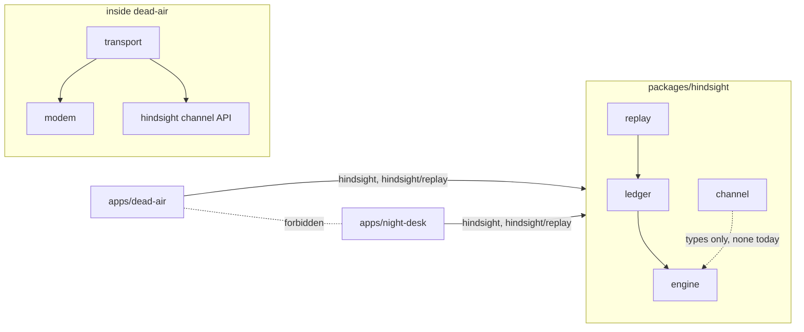
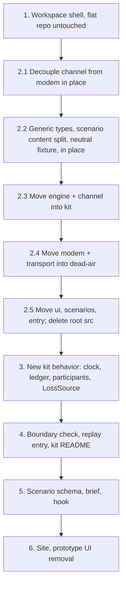

# Design: the skeleton (Hindsight kit and workspace)

## Overview

The flat repository (`src/engine`, `src/channel`, `src/modem`, `src/transport`, `src/ui`, one root `package.json`, 100 passing tests) becomes a pnpm workspace with three packages: the kit `packages/hindsight`, and the apps `apps/dead-air` and `apps/night-desk`. The work is a **move, not a rewrite**. Each file keeps its logic and its tests; only its location, its import specifiers and, where the requirements force it, a small set of named seams change.

Four things in the current code do not survive a plain move, because they would put app knowledge into the kit or kit code into the app. Each has a planned seam:

| # | Finding in the flat repo | Why it blocks a plain move | Seam |
|---|---|---|---|
| 1 | `src/channel/channel.ts` imports `../modem/frame` and calls `parse(frame(bytes))` on clean frames. | Kit would import the modem, which Req 4.4 puts in `apps/dead-air`. | The call is an identity on payloads of 0 to 64 bytes, so it is replaced by a payload copy. Behavior and seeded output are unchanged. The CRC contract stays tested in the modem. |
| 2 | `src/engine/types.ts` fixes `RoleId = "dispatch" \| "field"` and `Audience = RoleId \| "all"`. | Req 2.4: no fixed role names, no two-player assumption. | `ParticipantId = string`. `RoleId` stays as a type alias so existing call sites and tests compile unchanged. `"all"` is documented as a reserved audience. |
| 3 | `src/engine/scenario.ts` holds the scenario "Static on Channel 9" with radio wording. `engine.test.ts` imports it. | Req 2.3: no scenario content in the kit. | Content moves to `apps/dead-air/src/scenarios/`. `engine.test.ts` moves with it, keeps its file name and every assertion, and changes only import lines. A neutral three-participant fixture plus new generic tests cover the same reducer code inside the kit. |
| 4 | The words "modem" (comments in `channel.ts`, `channel-log.ts`, `prng.ts`) and "booth" (sender and recipient constants in `channel.prop.test.ts`) appear in kit files. | Req 2.3 forbids "resident", "booth", "modem" in the kit. | Comments are reworded. The test constants become `p1`..`p4`. The generators and assertions are untouched. |

Two requirements also need code that does not exist yet and is therefore new, small and additive: a **simulated clock** (Req 2.1 lists it; the repo has none) and the **ledger** (Req 2.1, 3.x). A third addition is the **loss-source interface** (Req 3.4), implemented so the current profile-driven behavior is one instance of it.

### Design decisions

- **Kit exports TypeScript source, no build step.** `packages/hindsight/package.json` has `exports` pointing at `./src/index.ts` and `./src/replay/index.ts`. Vite, Vitest and `tsc` with `moduleResolution: Bundler` resolve these through the workspace symlink. This removes a kit build, a watch process and a stale-`dist` failure mode. The kit's `build` script is `tsc --noEmit`.
- **The scenario stays one shape.** The schema in Req 5.1 validates the existing `Scenario` type (roles, events, decision prompts, debrief), generalized to participants. A second "scenario file" type that needs an adapter is not introduced. See Open Questions for the Night Desk risk.
- **No new runtime dependency.** The scenario validator and the brief parser are hand-written. `fast-check` is already allowed. React stays a dev and optional peer dependency of the kit, used only by the replay entry.
- **Boundary enforcement is a Node script, not a lint plugin.** It needs no dependency, runs in the same CI job and is itself property-tested.
- **Files are moved with `mv` and the import fix-up is done by `smart_relocate`-style edits, not `git mv`.** The developer commits by hand and git detects renames at commit time.

## Architecture

### Target layout

```
pnpm-workspace.yaml            packages/*, apps/*
package.json                   orchestrator only: scripts, no src/
tsconfig.base.json             strict settings shared by every package
packages/hindsight/
  package.json                 exports: "." and "./replay"
  README.md                    < 150 lines
  examples/minimal-drill.ts    the 30-line example, executed by a test
  src/
    index.ts                   core entry
    engine/    types, audience, reducer, channel-log, scenario schema + check, brief parse/print
    channel/   prng, clock, channel (LossSource)
    ledger/    ledger, from-channel adapter
    replay/    index.ts (separate entry), layout.ts (pure), ReplayView.tsx
apps/dead-air/
  package.json                 depends on hindsight (workspace:*)
  index.html, vite.config.ts   base "/dead-air/"
  src/modem/  src/transport/   moved from the flat repo
  src/scenarios/               Static on Channel 9 + its tests (+ briefs/)
  src/ui/                      prototype UI, removed at Req 6.2
apps/night-desk/
  package.json, index.html, vite.config.ts   base "/night-desk/"
  src/  scenarios/  scenarios/briefs/
site/                          landing page for "/"
scripts/boundaries/            import-boundary checker and its tests
scripts/site/                  assembles dist/ from site/ and both apps
```

### Import direction



Rules enforced by `scripts/boundaries` (Req 4.1 to 4.3, `structure.md`):

1. A file under `apps/X` may import only: its own files by relative path that stays inside `apps/X`, third-party packages, and the kit by the exact specifiers `hindsight` and `hindsight/replay`.
2. No file under `apps/X` imports from `apps/Y`, by relative path or package name.
3. No file under `packages/hindsight` has a relative import that leaves `packages/hindsight`, and none names an app package.
4. Inside the kit: `engine` imports no other kit folder. `ledger` imports only `engine`. `replay` imports only `ledger` and `engine`. `channel` imports nothing from `ledger` or `replay`.
5. Files reachable from `src/index.ts` import neither `react`, `react-dom`, nor reference `window`, `document`, `navigator`, `AudioContext`, `AudioWorkletNode` (Req 2.1).
6. Kit files contain none of the forbidden words (Req 2.3), and no `Math.random` or `Date.now` (`tech.md`).

### Move sequence and why this order keeps tests green

The flat repo and the workspace coexist until the last move. The root keeps legacy scripts (`test:flat`, `typecheck:flat`, `build:flat`) while `src/` exists, and the root `test`, `typecheck`, `build` run those plus the workspace run. Seams 1 to 3 are applied **in place, before any file moves**, so each later move is pure relocation plus import rewrites.



## Components and Interfaces

### Workspace (Req 1)

- `pnpm-workspace.yaml`: `packages: ["packages/*", "apps/*"]`.
- Root `package.json` scripts, final form:
  - `test`: `pnpm -r --filter "./packages/*" --filter "./apps/*" test && pnpm test:tooling`
  - `typecheck`: same filters with `typecheck`
  - `build`: same filters with `build`, then `node scripts/site/assemble.mjs`
  - `check:boundaries`: `node scripts/boundaries/run.mjs`
  - `test:tooling`: `vitest run --dir scripts`
  - `pnpm -r` stops at the first failing package and exits non-zero, which is Req 1.2. A config test asserts the scripts do not carry `--no-bail` or `|| true`.
- The root package filter excludes the root itself so `pnpm -r` cannot recurse into the orchestrator.
- Each package has `test`, `typecheck`, `build`. Shell packages use `vitest run --passWithNoTests` until they have tests.
- The shared `tsconfig.base.json` carries the current strict options (`strict`, `noUnusedLocals`, `noUnusedParameters`, `noFallthroughCasesInSwitch`). The kit's tsconfig sets `lib: ["ES2021"]` with **no DOM**, so a DOM reference in core fails typecheck. The replay folder has its own `tsconfig.replay.json` adding `DOM` and `jsx`, referenced from the kit build.

### Kit core entry (Req 2.1)

`packages/hindsight/src/index.ts` re-exports, by name, with no `export *` from files that carry internals:

| Area | Exports (existing name unless marked new) |
|---|---|
| Events and types | `ParticipantId` (new), `RoleId` (alias), `Audience`, `Role`, `EventType`, `SimEvent`, `DecisionOption`, `Scenario`, `RecordedDecision`, `PlayLog`, `SimState` |
| Log and reducer | `ChannelLog`, `ChannelLogEntry`, `ChannelOutcome`, `emptyChannelLog`, `toChannelLogEntry`, `appendChannelEvent`, `reduce`, `initialState`, `Action`, `nextSimTime`, `timelineSteps`, `messageTimings`, `buildDebrief` |
| Replay from log | `replay` (play log to state), `replayChannelLog` (outcomes to channel log) |
| Audience helpers | `visibleToRole`, `eventsForRole`, `allEvents`, `orderEvents` |
| Randomness and time | `Prng`, `createPrng`, `SimClock`, `createClock` (new) |
| Channel | `runChannel`, `ChannelProfile`, `ChannelSend`, `ChannelEvent`, `DEFAULT_AIRTIME`, `LossSource` (new), `Impairment` (new), `profileLoss` (new) |
| Ledger | `buildLedger`, `knownAt`, `inTransitAt`, `ledgerFromChannel`, `LedgerEvent`, `Ledger` (all new) |
| Scenario tooling | `validateScenario`, `checkScenario`, `parseBrief`, `printBrief`, `Brief` (all new, task group 5) |

### Participants (Req 2.4)

`ParticipantId` is `string`. `Audience` is `ParticipantId | "all"`; `"all"` is reserved and a scenario that declares a participant with that id fails validation. The reducer, `eventsForRole`, the ledger and the channel never enumerate participants and never hold a two-element assumption. `Scenario.decisionPrompts` becomes `Record<ParticipantId, ...>`.

### Simulated clock (Req 2.1, new)

```ts
interface SimClock {
  now(): number;                 // integer sim-time
  advance(by: number): number;   // by >= 0, integer; returns the new time
  advanceTo(t: number): number;  // t >= now(); throws RangeError otherwise
}
function createClock(start?: number): SimClock;
```

Sim-time is the engine's existing integer unit. The clock reads no wall clock. It is 15 to 25 lines.

### Loss source (Req 3.4)

One documented interface. The channel owns collision geometry and ordering; the loss source owns everything an app means by "lost": drop, delay and corruption of a send that did not collide.

```ts
interface Impairment {
  dropped: boolean;
  delay: number;          // integer sim-time units, >= 0
  payload: Uint8Array;    // bytes as the recipient would see them
  corrupted: boolean;     // true when payload no longer equals the sent bytes
}
interface LossSource {
  /** Called once per non-collided send, in the channel's stable order.
   *  Must take all randomness from `prng` and read no wall clock. */
  assess(send: ChannelSend, prng: Prng): Impairment;
}
function profileLoss(profile: ChannelProfile): LossSource;   // today's behavior
function runChannel(seed: number, loss: ChannelProfile | LossSource,
                    sends: readonly ChannelSend[]): ChannelEvent[];
```

`profileLoss` performs the current draw sequence exactly: drop, then delay, then one draw per payload bit. A `ChannelProfile` argument is wrapped with `profileLoss`, so every existing call and every seeded expectation is unchanged. Apps supply their own source:

- Dead Air: a source that models the acoustic link, or `profileLoss` for the simulated fallback.
- Night Desk: a source whose `assess` reads the player's attention state at `send.sendTime`, returning `dropped` or an extra `delay` when attention is elsewhere.

The `corrupted` flag keeps today's rule: any flipped bit yields a `garbled` event and no payload. The modem's CRC makes the same call on real frames, so the simulated and real paths agree on the outcome without the kit knowing about CRCs.

`ChannelSend`, `ChannelEvent`, `ChannelOutcome` and `ChannelLogEntry` gain an **optional** `id?: string`, copied through only when present. This lets the ledger identify a message. Existing deep-equality tests are unaffected because the key is absent when not supplied.

### Ledger (Req 2.1, 3.1 to 3.3, new)

The ledger answers "what did participant P know at time t". Facts reach a participant in two ways: scripted information the scenario hands them (a heard knock, a shown notice), and messages that arrive intact.

```ts
type LedgerEvent =
  | { kind: "learned"; participant: ParticipantId; factId: string; simTime: number }
  | { kind: "sent";    messageId: string; sender: ParticipantId; recipient: ParticipantId; simTime: number }
  | { kind: "outcome"; messageId: string; outcome: "received" | "garbled" | "collision"; simTime: number };

interface Ledger { readonly events: readonly LedgerEvent[] }

function buildLedger(events: readonly LedgerEvent[]): Ledger;       // sorts into a canonical order
function knownAt(l: Ledger, p: ParticipantId, t: number): ReadonlySet<string>;
function inTransitAt(l: Ledger, p: ParticipantId, t: number): ReadonlySet<string>;
function ledgerFromChannel(sends: readonly {id: string; sender: string; recipient: string; sendTime: number}[],
                           log: ChannelLog): LedgerEvent[];
```

Definition of `knownAt(l, p, t)`: the set of `factId` from `learned` events with `participant = p` and `simTime <= t`, plus the `messageId` of every message whose recipient is `p` and that has an `outcome: "received"` with `simTime <= t`. A message is **never** known if its outcome is `garbled` or `collision`, if it has no outcome (dropped, since the channel emits nothing for drops), or if its outcome time is after `t`. `inTransitAt` returns messages sent at or before `t` that have no outcome at or before `t`. The set can only gain members as `t` grows because membership is decided by `simTime <= t` conditions that only turn true. `ledger/` imports only `engine`; `ledgerFromChannel` reads `ChannelLogEntry`, which lives in `engine`.

Habits computed from the log (`structure.md` mentions them) are out of scope for this spec and belong to `seance-replay`.

### Replay entry (Req 2.2)

`hindsight/replay` exports `ReplayView` (React, SVG) and the pure `layoutReplay(ledger, scenario): ReplayLayout`. In this spec the view is a thin, working shell: one SVG row per participant, a tick per decision, markers for knowledge gained. The full design belongs to `seance-replay`. The core entry never imports `replay/`. `react` is an optional peer dependency.

### Scenario schema, check and brief (Req 5)

- `validateScenario(input: unknown): { ok: true; scenario: Scenario } | { ok: false; errors: ValidationError[] }`. It checks types and required fields, unique event ids, participant ids unique and not `"all"`, event audiences naming a declared participant or `"all"`, integer non-negative `simTime`, `linkedTo` naming an earlier event, and a `decisionPrompts` entry only for declared participants.
- `checkScenario(s: Scenario): CheckResult[]` returns named checks: `validates`, `beats-reachable`, `run-ends`, `decisions-have-options`. Definitions:
  - **Reachable beat:** its `simTime` is an integer in `[0, endTime]`, where `endTime` is the `debrief` event's time, and it is not preceded only by events that never occur (a `linkedTo` target exists and is earlier).
  - **Run ends:** exactly one `debrief` event exists and no event has a later `simTime`; `timelineSteps` reaches `endTime` in a finite number of steps.
  - **Decision options:** every entry in `decisionPrompts` has `options.length >= 2` and unique option ids.
- `parseBrief(md: string): { ok: true; brief: Brief } | { ok: false; errors }` and `printBrief(brief: Brief): string`. The brief grammar:

```
# <title>
## Participants
- <id>: <name> - <blurb>
## Beats
- <time> | <audience> | <type> | <title> | <body>
## Decisions
### <participant id>: <prompt>
- <option id>: <label>
```

`<time>` is a non-negative integer; `<audience>` is a participant id or `all`; `<type>` is one of the `EventType` values. Fields exclude the `|` character; the printer escapes it as `\|` and the parser reverses it, so round-trip holds for any text.

The generation step (brief to scenario file) is done by a Kiro hook that runs an agent, so it is not deterministic code. What is deterministic and tested is the validator and `checkScenario`, which every generated file must pass through the per-app test below.

### Per-app scenario test harness (Req 5.2)

Each app has `scenarios/scenarios.test.ts` that loads every scenario file in its `scenarios/` folder (a glob via `import.meta.glob`), and for each runs `validateScenario` and `checkScenario`. Adding a file adds coverage with no test edit. The hook writes the scenario file; the shared test is already in place.

### Boundary checker (Req 4)

`scripts/boundaries/check.mjs` exports a pure `checkBoundaries(files: Record<string, string>): Violation[]` over a path-to-source map. `run.mjs` reads the workspace and calls it, printing one line per violation and exiting 1 on any. It extracts specifiers from `import ... from`, `export ... from`, `import()` and `require()` using a regular expression over comment-stripped source, resolves relative specifiers against the file path, and applies the rules above. A test file `check.test.mjs` runs it on fixtures and on generated graphs. CI gets one added step, `pnpm check:boundaries`, before `pnpm test`.

### Site (Req 6)

`vite.config.ts` in each app sets `base` to `/dead-air/` or `/night-desk/`. `scripts/site/assemble.mjs` copies `site/` to `dist/`, `apps/night-desk/dist` to `dist/night-desk/`, and `apps/dead-air/dist` to `dist/dead-air/`, then fails if any of the three `index.html` files is missing. `vercel.json` keeps `outputDirectory: "dist"`.

## Data Models

```ts
// engine/types.ts after the move (changes marked)
type ParticipantId = string;                       // new
type RoleId = ParticipantId;                       // alias kept, was "dispatch" | "field"
type Audience = ParticipantId | "all";             // "all" reserved
interface Scenario { /* fields unchanged */ roles: Role[]; decisionPrompts: Record<ParticipantId, {...}>; ... }

// channel
interface ChannelSend  { id?: string; sender: string; recipient: string; sendTime: number; payload: Uint8Array; airtime?: number }
interface ChannelEvent { id?: string; kind: "received" | "garbled" | "collision"; simTime: number; sender: string; recipient: string; payload?: Uint8Array }

// ledger: see Components. LedgerEvent is plain JSON data so a ledger serializes with JSON.stringify.
```

`Brief` is `{ title: string; participants: {id, name, blurb}[]; beats: {time, audience, type, title, body}[]; decisions: {participant, prompt, options: {id, label}[]}[] }`.


## Correctness Properties

*A property is a characteristic or behavior that should hold true across all valid executions of a system-essentially, a formal statement about what the system should do. Properties serve as the bridge between human-readable specifications and machine-verifiable correctness guarantees.*

After reflection, the import-direction criteria (2.1, 2.2, 4.1, 4.2, 4.3) all reduce to one checker, so they share Property 7. Word and API bans (2.3, `tech.md`) share Property 8. The workspace, README, site, hook and deletion criteria are example or smoke checks, listed in the Testing Strategy.

### Property 1: Clock only moves forward by what it is told

For any start time and any sequence of non-negative integer advances, `now()` after each step equals the start plus the sum of advances so far, never decreases, and `advanceTo(t)` with `t` less than `now()` throws and leaves `now()` unchanged.

**Validates: Requirements 2.1**

### Property 2: Replay determinism

For any valid scenario, any set of recorded decisions, any channel profile, any sends and any seed, running the pipeline (`runChannel`, `replayChannelLog`, `replay`, `buildLedger`) twice yields structurally equal channel logs, simulation states and ledgers.

**Validates: Requirements 3.1**

### Property 3: Known set only grows

For any ledger, any participant and any times `t1 <= t2`, `knownAt(ledger, p, t1)` is a subset of `knownAt(ledger, p, t2)`.

**Validates: Requirements 3.2**

### Property 4: Only intact, arrived messages are known

For any set of sends run through the real channel under any profile and seed, any participant `p` and any time `t`, a message id is in `knownAt(ledger, p, t)` if and only if its recipient is `p` and the channel emitted a `received` event for it with `simTime <= t`. Every message that was dropped, garbled, collided, or has an outcome after `t` is absent, and appears in `inTransitAt` only when it was sent at or before `t` with no outcome at or before `t`.

**Validates: Requirements 3.3**

### Property 5: The kit does not care how many participants there are

For any number of participants from 1 to 12 with arbitrary distinct string ids other than `"all"`, a generated scenario over them validates, `eventsForRole` returns for each participant exactly the events whose audience is that participant or `"all"`, and the ledger's `knownAt` for each participant only contains facts addressed to that participant.

**Validates: Requirements 2.4**

### Property 6: Profile and loss source are one interface

For any seed, profile and sends, `runChannel(seed, profile, sends)` equals `runChannel(seed, profileLoss(profile), sends)`. For any loss source that drops a chosen subset of sends, no dropped send produces a `received` event. For any loss source that adds a fixed extra delay, every `received` event's `simTime` is at least `sendTime + extra`. For any loss source and seed, two runs give equal output.

**Validates: Requirements 3.4**

### Property 7: The boundary checker flags exactly the forbidden imports

For any generated set of source files with generated import specifiers, `checkBoundaries` reports a violation for an import if and only if it is one of: an app file importing by a relative path that leaves its app folder; an app file importing another app; an app file importing a kit path other than `hindsight` or `hindsight/replay`; a kit file importing outside the kit or naming an app; a kit folder importing against the direction `engine`, `ledger`, `replay`; a file reachable from the core entry importing `react`, `react-dom` or a DOM or Web Audio global.

**Validates: Requirements 2.1, 2.2, 4.1, 4.2, 4.3**

### Property 8: Forbidden content in the kit is always found

For any kit source text with a forbidden word (`resident`, `booth`, `modem`, plus the extra app words) inserted at any position and in any letter case, or with `Math.random` or `Date.now` inserted, the scanner reports it; for any text containing none of them, it reports nothing.

**Validates: Requirements 2.3**

### Property 9: Brief round trip

For any valid `Brief` (including text containing `|`, leading and trailing spaces trimmed, and non-ASCII characters), `parseBrief(printBrief(brief))` returns an equal `Brief`, and `printBrief` of the result equals the first printed text.

**Validates: Requirements 5.1**

### Property 10: Scenario checks accept valid scenarios and reject each fault

For any generated valid scenario, `validateScenario` succeeds and every result of `checkScenario` passes. For any valid scenario with exactly one injected fault (a decision with fewer than two options, a `linkedTo` naming a missing or later event, an event after the debrief, a missing debrief, a duplicate event id, an audience naming no participant), `validateScenario` or `checkScenario` reports a failure naming that fault.

**Validates: Requirements 5.1, 5.2**

## Error Handling

- `createClock().advance(n)` with `n < 0` or a non-integer throws `RangeError`; `advanceTo(t)` with `t < now()` throws `RangeError`.
- `runChannel` with a `LossSource` that returns a negative or non-integer `delay` throws `RangeError` naming the send id, instead of emitting an event before its send time (which would break the "no early delivery" rule).
- `knownAt` and `inTransitAt` on an unknown participant return an empty set. An `outcome` event whose `messageId` has no `sent` record is ignored by the ledger and counted in `ledger.orphans`, so a bad adapter is visible and not silently absorbed.
- `validateScenario` never throws on any input value. It returns every error found, each with a JSON-pointer-style `path` and a message.
- `parseBrief` returns errors with a 1-based line number; it never throws and never partially returns a brief.
- The boundary checker prints `file:line specifier rule` for each violation and exits 1. A file it cannot read is itself a violation, so a typo in a path cannot hide a failure.
- `scripts/site/assemble.mjs` exits 1 with the missing path if any of the three entry files is absent after the copy.
- A `pnpm` package that fails stops the recursive run with that package's exit code.

## Testing Strategy

**Why both kinds.** The kit's new behavior is pure logic over plain data (clock, ledger, loss source, schema, brief, checker), where property tests find edge cases that examples miss. The move itself, the workspace wiring, the README, the site and the hook are configuration and structure, where one or two examples are the right test.

**Property tests** use `fast-check` (already allowed; nothing is written from scratch). Each runs at least 100 iterations (`numRuns: 100` minimum), lives beside its code as `x.prop.test.ts`, implements exactly one design property, and carries the tag `Feature: skeleton, Property N: <property text>` in a comment. Properties 1 to 6 sit in `packages/hindsight/src/`. Properties 7 and 8 sit in `scripts/boundaries/check.prop.test.mjs`. Properties 9 and 10 sit in `packages/hindsight/src/engine/`.

**Existing tests.** The 100 existing tests are not rewritten. They move with their code. Allowed edits to a moved test are limited to import specifiers and, for `channel.prop.test.ts`, the sender and recipient constants (`booth` and friends become `p1`..`p4`). `engine.test.ts` keeps its name and assertions and moves to `apps/dead-air/src/scenarios/`. Each move task records the test count before and after. The compile-time `TransportEvent` assignability line in `replay-channel.test.ts` moves into `apps/dead-air/src/transport/outcome-fit.test.ts`, because the transport type lives in the app.

**Example and smoke tests.**
- Workspace config test (`scripts/workspace.test.mjs`): three packages each have a `package.json`; root scripts use the recursive filter and no failure-swallowing; `pnpm-workspace.yaml` globs.
- Golden vector tests for `runChannel` on fixed seeds, recorded before seam 1 and re-asserted after it, to prove the modem decoupling changed nothing.
- Core entry export list test, and a runtime test that imports the core entry with `react` mocked to throw.
- Replay entry render test (jsdom) and `layoutReplay` example.
- README test: fewer than 150 lines, contains one fenced block that equals `examples/minimal-drill.ts` (at most 30 non-blank lines), and `minimal-drill.test.ts` runs that example.
- Site assembly test on a temp directory; `ci.yml` contains the boundary step; the three prototype UI files are absent after task F2.

**Not property-tested, with reasons.** Workspace scripts, CI wiring, the Kiro hook and the site build are configuration. The brief-to-scenario step is performed by an agent and is verified by running its output through the property-tested validator and the per-app scenario test.

**Done for every task.** `pnpm typecheck`, `pnpm test` and `pnpm build` pass at the root, and the test count never drops below the previous task's count unless the task states which tests were deleted and why.

## Open Questions

1. **One decision per participant.** `Scenario.decisionPrompts` allows one prompt per participant, which fits the prototype. Night Desk may need several decisions per participant. If so, `night-desk` extends the schema with a `version` field in a later change; this spec does not guess its shape.
2. **Dead Air's real transport and the `id` field.** The acoustic transport must carry a message id end to end for the ledger to attribute outcomes. Until `signal-chain` task C1 does this, the ledger for Dead Air is fed by the scripted and loopback transports.
3. **Offline use (`product.md`).** A service worker is outside this spec. The site build only guarantees static output.
